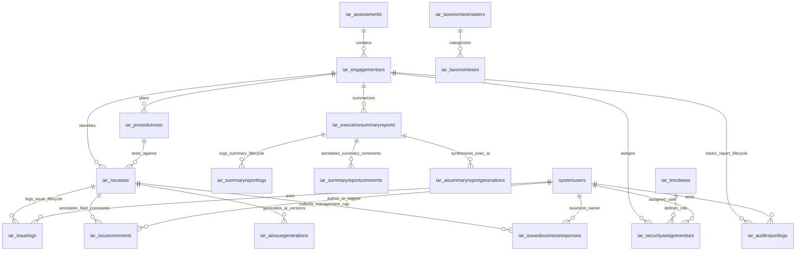

# Dataverse Schema & Data Model Specification
## Production Schema Catalog, Relational Architecture, OptionSets & Upcoming Entities

---

## 1. Executive Purpose & Architectural Scope

This specification defines the complete Microsoft Dataverse data model for the **IAR (Intelligent Audit Reporting)** enterprise platform. It serves as the authoritative architectural blueprint bridging:
1. **Power Apps CLI Generated Services & Models** (`src/generated/models/`, `src/generated/services/`, `.power/schemas/appschemas/dataSourcesInfo.ts`).
2. **Current Live Dataverse Tables** (Layer 1: Loaded via Dataverse Web API connector under publisher prefix `iar_`).
3. **Upcoming Operational Dataverse Tables** (Layer 2: Logging, Field Comments, AI Synthesis Versions, Executive Summary Studio, and Business Response Loop).

### Dataverse Environment Metadata:
- **Organization URL**: `https://orge7f34042.api.crm8.dynamics.com/`
- **Solution Publisher Prefix**: `iar_`
- **Connector Type**: Microsoft Dataverse Native Connector (`@microsoft/power-apps/data`)

---

## 2. Master Entity Relational Diagram (ERD)



---

## 3. Layer 1: Loaded & Generated Dataverse Tables (Active)

These 9 entities are active in the environment and have models/services in `src/generated/`. They are partitioned by their data ingestion and management lifecycle:

### 3.0 Master Ingestion Architecture vs. App-Managed Governance

> [!IMPORTANT]
> **Upstream Synchronization Mechanism (Hourly Scheduled Flow)**:
> The tables `iar_assessments`, `iar_engagementses`, `iar_procedureses`, `iar_securityassignmentses`, `iar_taxonomiesmasters`, and `iar_taxonomieses` are **loaded and maintained by Scheduled Power Automate flows executing every 1 hour**.
> - The flow polls upstream audit planning, enterprise systems, and ERP repositories for newly created or modified records.
> - Dataverse records are automatically created or updated.
> - Inside the **IAR Power Apps Code App**, these entities serve primarily as **read-only master reference catalogs and lookup sources** (populating audit queues, test procedure selectors, assigned auditor lists, and taxonomies).
>
> In contrast, **`iar_issueses`** and all Layer 2 operational tables (logs, comments, AI generations, executive reports, business responses) are **natively authored, modified, transitioned, and governed directly within the IAR Code App**.

| Dataverse Logical Name | Display Name | Ingestion & Ownership Model | Primary Key | Generated TypeScript Model | Generated Service Class |
| :--- | :--- | :--- | :--- | :--- | :--- |
| **`iar_assessments`** | Annual Assessment Portfolio | **Scheduled Flow (Hourly Sync)** | `iar_assessmentid` | [`Iar_assessmentsModel.ts`](file:///d:/IAR/src/generated/models/Iar_assessmentsModel.ts) | [`Iar_assessmentsService.ts`](file:///d:/IAR/src/generated/services/Iar_assessmentsService.ts) |
| **`iar_engagementses`** | Audit Engagement Project | **Scheduled Flow (Hourly Sync)** | `iar_engagementsid` | [`Iar_engagementsesModel.ts`](file:///d:/IAR/src/generated/models/Iar_engagementsesModel.ts) | [`Iar_engagementsesService.ts`](file:///d:/IAR/src/generated/services/Iar_engagementsesService.ts) |
| **`iar_procedureses`** | Audit Test Procedure | **Scheduled Flow (Hourly Sync)** | `iar_proceduresid` | [`Iar_proceduresesModel.ts`](file:///d:/IAR/src/generated/models/Iar_proceduresesModel.ts) | [`Iar_proceduresesService.ts`](file:///d:/IAR/src/generated/services/Iar_proceduresesService.ts) |
| **`iar_securityassignmentses`**| Security / Role Assignment | **Scheduled Flow (Hourly Sync)** | `iar_securityassignmentsid` | [`Iar_securityassignmentsesModel.ts`](file:///d:/IAR/src/generated/models/Iar_securityassignmentsesModel.ts) | [`Iar_securityassignmentsesService.ts`](file:///d:/IAR/src/generated/services/Iar_securityassignmentsesService.ts) |
| **`iar_taxonomieses`** | Audit Taxonomy Term | **Scheduled Flow (Hourly Sync)** | `iar_taxonomiesid` | [`Iar_taxonomiesesModel.ts`](file:///d:/IAR/src/generated/models/Iar_taxonomiesesModel.ts) | [`Iar_taxonomiesesService.ts`](file:///d:/IAR/src/generated/services/Iar_taxonomiesesService.ts) |
| **`iar_taxonomiesmasters`** | Taxonomy Master Category | **Scheduled Flow (Hourly Sync from TeamMate)** | `iar_taxonomiesmasterid` | [`Iar_taxonomiesmastersModel.ts`](file:///d:/IAR/src/generated/models/Iar_taxonomiesmastersModel.ts) | [`Iar_taxonomiesmastersService.ts`](file:///d:/IAR/src/generated/services/Iar_taxonomiesmastersService.ts) |
| **`iar_tmroleses`** | Team Roles Catalog | **One-Time Deployment Seed Flow (TeamMate)** | `iar_tmrolesid` | [`Iar_tmrolesesModel.ts`](file:///d:/IAR/src/generated/models/Iar_tmrolesesModel.ts) | [`Iar_tmrolesesService.ts`](file:///d:/IAR/src/generated/services/Iar_tmrolesesService.ts) |
| **`systemusers`** | Entra ID / CRM User Directory | **Dataverse System Entity** | `systemuserid` | [`SystemusersModel.ts`](file:///d:/IAR/src/generated/models/SystemusersModel.ts) | [`SystemusersService.ts`](file:///d:/IAR/src/generated/services/SystemusersService.ts) |
| **`iar_administratorses`** | Application Administrators Directory | **Application-Managed (Loaded)** | `iar_administratorsid` | [`Iar_administratorsesModel.ts`](file:///d:/IAR/src/generated/models/Iar_administratorsesModel.ts) | [`Iar_administratorsesService.ts`](file:///d:/IAR/src/generated/services/Iar_administratorsesService.ts) |
| **`iar_issueses`** | Audit Issue / Finding Workpaper | **Application-Managed (Loaded)** | `iar_issuesid` | [`Iar_issuesesModel.ts`](file:///d:/IAR/src/generated/models/Iar_issuesesModel.ts) | [`Iar_issuesesService.ts`](file:///d:/IAR/src/generated/services/Iar_issuesesService.ts) |


---

### 3.1 Entity Details & Schema Attributes

#### 1. `iar_assessments` (Annual Audit Portfolio)
- **Primary Key**: `iar_assessmentid` (string / GUID)
- **Source & Synchronization**: Synchronized every 1 hour via Scheduled Flow from TeamMate.
- **Attributes & Observed Dataverse Columns**:
  - `iar_name` / `iar_assessmentid`: Assessment ID string (e.g. `113`, `138`, `143`).
  - `iar_assessmenttitle`: Full Title string (e.g. `2024 Internal Audit Assessment`, `2025 Internal Audit Assessment`, `2026 Internal Audit Assessment`).
  - `iar_description`: Description narrative (e.g. `2026 Internal Audit Assessment`).
  - `iar_startdate`: Date and Time (`1/1/2024`, `1/1/2025`, `1/1/2026`).
  - `iar_enddate`: Date and Time (`12/31/2024`, `12/31/2025`, `12/31/2026`).
  - `iar_assessmentstateid`: Integer string state identifier (`1`, `2`, `3`).
  - `iar_assessmentstate`: Text state label:
    - **`1` $\rightarrow$ `Open`** (Active assessment year currently accepting audit activity)
    - **`2` $\rightarrow$ `Finalized`** (Archived assessment year; reports completed)
    - **`3` $\rightarrow$ `Reopened`** (Prior assessment year reopened for supplemental reporting or adjustments)
  - `iar_tmlastmodified`: TeamMate synchronization timestamp (e.g. `4/15/2021 8:22 PM`).
  - `statecode` / `statuscode`: Active (`statecode: 0`, `statuscode: 1`).
- **Domain Constraints & Application Consumption Rules**:
  1. **Strict 1:1 Calendar Year Invariant**:
     - Assessments strictly correspond to exactly one calendar year.
     - An assessment **never spans multiple years**, and **a single calendar year never has multiple assessments**.
  2. **Power Automate Master Ingestion Scoping**:
     - Used by the hourly sync flow (`FLW-IAR-HourlyMasterDataSync`) to determine which active/open assessment's engagements to synchronize into Dataverse from TeamMate.
  3. **Audit Queue Filter**:
     - Serves as the primary portfolio filter on the Audit Queue page: **Assessment Year**, parsed from `iar_startdate` (e.g. `2026`, `2025`, `2024`), accompanied by the **Assessment State** rendered as a colored status pill (`Open` [green], `Finalized` [neutral], `Reopened` [amber]) directly on the filter item.
     - **Default Filter**: Defaults automatically to the **current calendar year** upon application load.
  4. **Executive Report Period Header**:
     - The `iar_assessmenttitle` dynamically populates the **Assessment Period** on the Executive Summary Report.


#### 2. `iar_engagementses` (Audit Engagement Project)
- **Primary Key**: `iar_engagementsid` (string / GUID, e.g. `7631f130-18c0-f111-b377-7c1e52...`)
- **Foreign Key / Lookups**:
  - `"iar_AssessmentID@odata.bind"`: Reference to parent `iar_assessments` (displayed as `Assessment ID *` in Dataverse, matching `iar_name` e.g. `113`, `138`, `143`).
- **Attributes & Observed Columns**:
  - `iar_engagementcode`: Business Engagement Code (e.g. `20260001`, `20260003`, `20260004`...).
  - `iar_name`: Unique upstream Engagement ID string (e.g. `1764`, `1765`, `1766`...).
  - `iar_engagementname`: Full Engagement Title string (e.g. `GS Bogota - Revenue process`, `Innovative Medicine Saudi`, `Patient Service Center`).
  - `iar_reportstatus`: OptionSet (`Iar_engagementsesiar_reportstatus`) tracking engagement reporting progress:
    - `822500000` $\rightarrow$ **`Not Started`**
    - `822500001` $\rightarrow$ **`Audit Report Inprogress`**
    - `822500002` $\rightarrow$ **`Executive Report Inprogress`**
    - `822500003` $\rightarrow$ **`Completed`**
  - `iar_tmlastmodified`: TeamMate synchronization timestamp (e.g. `4/27/2026 8:27 PM`).
  - `statecode` / `statuscode`: Active (`statecode: 0`, `statuscode: 1`).
  - Upstream TeamMate Pass-Through Metadata:
    - `iar_engagementtypeid` (`1291`) / `iar_engagementtype` (`RBA - Risk Based Audit`).
    - `iar_engagementstateid` (`1`, `2`) / `iar_engagementstate` (`Open`, `Closed`).
- **Domain Constraints & Application Rules**:
  1. **Primary Screen Presentation (`iar_engagementname`)**:
     - `iar_engagementname` is the human-readable headline title displayed across all screens (Audit Queue table, Audit Report Studio workpaper header, Executive Report Studio, navigation drawers, and breadcrumbs).
     - **No Queue ID Column in Queue Grid**: The primary Audit Queue grid does not render an Engagement ID / Queue ID column; the row is headlined directly by the `Engagement` (`iar_engagementname`) title.
  2. **No Logic Significance for Engagement Type & Engagement State**:
     - Upstream columns `iar_engagementtype` and `iar_engagementstate` have **no operational significance** in IAR business logic, routing state machines, or UI permission checks.
  3. **Engagement-Level Lifecycle Tracking via `iar_reportstatus`**:
     - `iar_reportstatus` is the single source of truth for engagement progress, initialized as **`Not Started`** upon ingestion from TeamMate.
     - **Branch A (Findings-Driven Audit)**: When an auditor creates the first finding/issue under the engagement, `iar_reportstatus` automatically transitions from `Not Started` $\rightarrow$ **`Audit Report Inprogress`**.
     - **Branch B (Zero-Issue / Summary-Only Audit)**: If an engagement concludes fieldwork without any negative findings, the auditor works directly on the Executive Summary. Saving or submitting the executive report transitions `iar_reportstatus` directly from `Not Started` $\rightarrow$ **`Executive Report Inprogress`**.
     - **Action Button Availability**: Because of this dual-path lifecycle, `Not Started` rows render both **`+ Create Issue`** and **`Work on Executive Summary`** action buttons.


#### 3. `iar_procedureses` (Audit Test Procedure Workprogram)
- **Primary Key**: `iar_proceduresid` (string / GUID)
- **Source & Synchronization**: Synchronized every 1 hour via Scheduled Flow from TeamMate.
- **Lookups / Bindings**:
  - `"iar_EngagementID@odata.bind"`: Reference to parent `iar_engagementses` (displayed as `Engagement ID *` in Dataverse, e.g. `1854`, `1764`, `1765`, `1766`).
- **Attributes & Observed Columns**:
  - `iar_name`: Auto-numbered Procedure ID string (e.g. `11074`, `13596`, `13597`, `13598`...).
  - `iar_procedurecode`: Upstream Procedure Code string (e.g. `1`, `2`, `3`...).
  - `iar_procedurename`: Procedure Name string (e.g. `SAS_99 Planning`, `Kick-off Meeting`, `Interim Meeting`, `Audit Conclusion`, `Final Meeting`...).
  - `iar_procedurestateid`: Upstream Procedure State ID string (e.g. `5`).
  - `iar_procedurestate`: Upstream Procedure State text (e.g. `Reviewed`).
  - `iar_tmlastmodified`: TeamMate modification timestamp.
  - `statecode` / `statuscode`: Active (`statecode: 0`, `statuscode: 1`).
- **Domain Constraints & Application Rules**:
  1. **Strict Engagement Scoping**:
     - Procedures represent approved fieldwork audit programs and strictly belong to an individual engagement (`iar_engagementses`).
  2. **Issue Authoring Binding & Dropdown Presentation**:
     - When authoring a finding (in the `+ Create Issue` drawer/dialog), the auditor selects a procedure from a dropdown populated with procedures scoped to the current engagement.
     - **Dropdown Display Format**: Renders the **simple procedure name** (`iar_procedurename`) directly, without prepending procedure code or numeric prefixes.
     - **1-to-Many Issue Cardinality**: A single test procedure can have zero, one, or **multiple findings/issues** linked to it within the engagement.
     - The selected procedure is stored on each linked finding as `"iar_TestProcedure@odata.bind"`.
  3. **No Operational Significance for Procedure State**:
     - Upstream columns `iar_procedurestate` and `iar_procedurestateid` are pass-through metadata from TeamMate with **no operational significance** in application logic, filtering, or routing. All active procedures under the selected engagement are selectable by the auditor regardless of their procedure state.


#### 4. `iar_issueses` (Audit Finding / Issue Workpaper)
- **Primary Key**: `iar_issuesid` (string / GUID)
- **Secondary / Display Key**: `iar_issueid` (e.g. `ISS-01`, `ISS-02`)
- **Lookups / Bindings**:
  - `"iar_EngagementID@odata.bind"`: Parent engagement.
  - `"iar_TestProcedure@odata.bind"`: Linked procedure.
  - `"iar_CurrentOwner@odata.bind"`: System user currently responsible for the issue.
  - `"iar_LockedBy@odata.bind"`: User currently holding the soft editing lock.
  - Taxonomies: `"iar_Criticality@odata.bind"`, `"iar_AccountableFunction@odata.bind"`, `"iar_ImpactedSector@odata.bind"`, `"iar_ImpactedRegion@odata.bind"`, `"iar_ImpactedMRC@odata.bind"`, `"iar_ProcessArea@odata.bind"`, `"iar_IssueType@odata.bind"`, `"iar_IssueCauseType@odata.bind"`, `"iar_IssueSource@odata.bind"`, `"iar_KeyTheme@odata.bind"`, `"iar_RepeatFinding@odata.bind"`, `"iar_QuarterImpacted@odata.bind"`, `"iar_ITAssetAccountableSector@odata.bind"`.
- **Core Narrative Workpaper Fields**:
  - `iar_issuetitle`: Headline finding title.
  - `iar_description`: Background and condition narrative.
  - `iar_originalissue`: Initial unrefined auditor finding note.
  - `iar_rootcause`: Why the failure occurred.
  - `iar_impact`: Business, operational, or regulatory risk.
  - `iar_recommendation`: Remediation guidance for management.
  - `iar_summaryfinding`: Executive concise synopsis.
  - `iar_mitigatingcontrol`: Existing compensating controls.
  - `iar_auditorresponse`: Auditor's rebuttal or commentary.
  - `iar_reportreference`: Cross-reference code in final report.
- **Financial Quantification**:
  - `iar_salesusd`: Impacted sales volume.
  - `iar_netincomeusd`: Net income financial impact.
  - `iar_totalassetsusd`: Total asset base involved.
  - `iar_ibtusd`: Income Before Taxes impact.
- **Governance, Business Ownership & Concurrency**:
  - **Strictly No Permanent Deletion**: Findings are **never permanently deleted**; audit trail integrity requires soft exclusion exclusively via `iar_issuestatus: 822500009` (`Excluded`).
  - **Two-Stage Mandatory Fields Progression**:
    - **Stage 1 (Initial Issue Creation in `CreateIssueDialog` / AI Generation)**:
      - ONLY 3 fields are strictly mandatory:
        1. **Test Procedure** (`iar_TestProcedure`)
        2. **Function** (`iar_function`: IT [`822500000`] or FinOps [`822500001`])
        3. **Original Issue** (`iar_originalissue`)
      - All other finding attributes (Primary Business Owner, Criticality, Accountable Function, Process Area, etc.) are optional during initial creation.
    - **Stage 2 (Manager Submission Gate)**:
      - Before an issue can advance from Audit Manager review (`Pending Manager` $\rightarrow$ `Ready for Director Submission` / batch submission to Director), the following fields become **strictly mandatory**:
        1. **Primary Business Owner** (`iar_PrimaryBusinessOwner`) — MUST be assigned before leaving Manager tier.
        2. **Criticality** (`iar_criticality`)
        3. **Root Cause** (`iar_rootcause`)
        4. **Impact** (`iar_impact`)
        5. **Recommendations** (`iar_recommendations`)
        6. **Accountable Function** (`iar_AccountableFunction`)
        7. **Accountable Process Area** (Taxonomy)
  - `iar_issuestatus`: Review state machine (see Section 3.2: `Pending Staff` [`822500000`], `Pending TC` [`822500001`], `Pending Manager` [`822500002`], `Manager Completed (Waiting for Other Issues)` [`822500003`], `Ready for Director Submission` [`822500004`], `Pending Director` [`822500005`], `Pending Business` [`822500006`], `Pending VP` [`822500007`], `Completed` [`822500008`], and **`Excluded`** [`822500009`]).
    - *Creator-Driven Initial Status*:
      - *Staff Creator*: Save Draft $\rightarrow$ `Pending Staff` (`822500000`); Submit $\rightarrow$ `Pending TC` (`822500001`).
      - *TC Creator*: Save Draft $\rightarrow$ `Pending TC` (`822500001`); Submit $\rightarrow$ `Pending Manager` (`822500002`).
      - *Manager Creator*: Save Draft $\rightarrow$ `Pending Manager` (`822500002`); Submit $\rightarrow$ `Manager Completed (Waiting for Other Issues)` (`822500003`) if other active issues are pending, or `Ready for Director Submission` (`822500004`) if all sibling active issues are completed. *(Note: Excluded issues are treated as soft-deleted and do NOT block or influence this batch transition).*
    - *Exclusion & Re-inclusion*: When excluded, status becomes `Excluded` (`822500009`). Excluded issues are exempted from Manager batch gating checks. When re-included ("Include Issue in Report"), transitions directly into **`Pending with [Persona performing include]`** (Staff $\rightarrow$ `Pending Staff`, TC $\rightarrow$ `Pending TC`, Manager $\rightarrow$ `Pending Manager`, Director $\rightarrow$ `Pending Director`).
    - *Call Back (Pull)*: Standalone button enabling any persona to recall an issue from an upper-level queue down to `Pending with [Calling Persona]`.
    - *Send To (Push)*: Standalone button (adjacent to Call Back) displaying a modal listing **only users assigned to the current engagement** in `iar_securityassignmentses`. Updating sets `iar_issuestatus` to `Pending [Target Persona]` and binds `"iar_CurrentOwner@odata.bind"` to the selected user's `systemusers` record. Distinct from Director-only "Send to Business" which formally dispatches to auditees.
    - *Team Member Edit Permissions*: Any assigned team member can edit finding fields across all active `Pending` states (`Pending Staff`, `Pending TC`, `Pending Manager`, `Pending Director`), fostering agile team collaboration.
  - `iar_function`: Track/domain choice (`IT` [`822500000`] or `FinOps` [`822500001`]). **Used strictly to supply the `technology_related` parameter** (boolean: `true` for IT, `false` for FinOps) when calling the AI microservice via `AIIssueGeneration`. Toggled between `IT` and `FinOps` via **"Mark Not My Function Issue"** with mandatory justification.
  - `"iar_AccountableFunction@odata.bind"`: Dedicated finding attribute lookup to `iar_taxonomieses` storing the operational business function responsible for the auditable area, strictly distinct from `iar_function`.
  - `iar_workflowremarks` *(Recommended Operational Field)*: Multiple Lines of Text (nvarchar(max)) storing the most recent workflow reason/remark (exclusion reason, call back reason, send to note, re-inclusion reason). Enables instant rendering of contextual workpaper banners and queue card alerts without secondary log queries.
  - **Secondary Business Owners**: Managed in separate 1:N relational table **`iar_issuebusinessownerses`** (supporting multiple secondary owners with delegation tracking).
  - `iar_soxreportable`: Boolean flag for SOX 404 material weakness / deficiency.
  - `iar_lockstatus` & `"iar_LockedBy@odata.bind"` *(Automatic Inactivity-Aware Soft Locking, 1-Hour Auto-Unlock & Auto-Save)*:
    - **No manual lock button on UI**: Soft lock is acquired automatically as soon as an active user begins modifying or editing any finding field (`iar_lockstatus = true`, `iar_LockedBy` bound to editor GUID).
    - **Concurrent User Lockout**: Other users viewing concurrently see an active locking banner (*"🔒 Currently being edited by [User Name] — changes are locked for other users"*) with all fields and workflow buttons disabled.
    - **Normal Release**: Released immediately when the current user completes or leaves: upon clicking Submit, clicking Cancel, navigating to another finding in the Finding Navigator, or closing the browser tab. Once released, other users are instantly enabled.
    - **Inactive Mode 1-Hour Auto-Unlock**: If the active user is inactive for 59 minutes, a 60-second countdown warning appears. If no activity is registered within the countdown (reaching 1 hour total inactivity), the application automatically clears the lock (`iar_lockstatus = false`, `iar_LockedBy = null`), reverts the user to view mode, and re-enables editing for all other users.
    - **Stale Lock Lease Expiry Safety Net**: In the event of a sudden client crash or disconnected state, locks older than 1 hour without active heartbeat are evaluated as expired and automatically evicted when another user accesses the finding.
    - **Debounced Auto-Save (Zero New Columns Required)**: Continuous debounced auto-save (1.5s–2s) patches finding changes directly to `iar_issueses`. Native Dataverse system fields (`modifiedon`, `_modifiedby_value`) automatically record the save timestamp and user identity, while the UI displays a clean status indicator (*"Saving..."* / *"All changes saved"*). Submissions remain strictly manual. GxP audit trail logs in `iar_issuelogses` (`iar_logtype: 3 Field Edits`) are triggered on field blur or submission rather than on every raw auto-save keystroke.
  - `iar_exceptionremedcomments`, `iar_exceptionremeddate`: Exception & remediation timelines.
- **Roadmap & Schema Evolution Notes**:
  - Some UI fields in the issue workpaper are yet to be created in Dataverse and will be added later.
  - Taxonomy-driven fields (`Process Area`, `Issue Type`, `Issue Cause Type`, `Issue Source`, `Key Theme`, `Repeat Finding`, `IT Asset Accountable Sector`, `Impacted Region`, `Impacted Sector`, `Impacted MRC`, `Quarter Impacted`, `Criticality`) bind to `iar_taxonomieses` and will be hooked to UI controls.
  - Operational column `iar_workflowremarks` is recommended for addition to `iar_issueses` to mirror the column already existing in `iar_issuelogses`.


#### 5. `iar_securityassignmentses` (User Role Engagement Assignment)
- **Primary Key**: `iar_securityassignmentsid` (string / GUID)
- **Source & Synchronization**: Synchronized every 1 hour via Scheduled Flow from TeamMate.
- **Lookups / Bindings**:
  - `"iar_EngagementID@odata.bind"`: Foreign Key reference to parent `iar_engagementses` (displayed as `Engagement ID *` in Dataverse, e.g. `1766`, `1813`, `1857`, `1800`, `1811`).
- **Attributes & Observed Columns**:
  - `iar_name`: Auto-numbered Assignment ID string (e.g. `100`, `101`, `102`...).
  - `iar_useremailid`: User email address string (e.g. `tamil@conversedatasolution.onmicrosoft.com`, `gowrip@...`, `ranjitha@...`).
  - `iar_tmroleid`: **TeamMate Role ID** string (e.g. `5` for IT MGR, `8` for FIN DIR, `6` for FIN MGR). *Relational lookup to `iar_tmroleses.iar_tmid`*.
  - `iar_tmrolename`: TeamMate role title snapshot (e.g. `IT MGR`, `FIN DIR`, `FIN MGR`).
  - `iar_tmuserid`: Upstream TeamMate User ID string (e.g. `11`, `12`, `13`).
  - `statecode` / `statuscode`: Active (`statecode: 0`, `statuscode: 1`).
- **Identity & Role Resolution Mechanisms**:
  1. **User Identity Resolution (`iar_useremailid` $\rightarrow$ `systemusers`)**:
     - The application takes `iar_useremailid` from the security assignment and queries the Dataverse **`systemusers`** table matching on `systemusers.internalemailaddress` (or fallback `domainname`).
     - Extracts the user's `systemuserid` (GUID), `fullname` (display name e.g. `Tamilselvan`, `Gowri P`, `Ranjitha`), `firstname`, `lastname`, and Entra avatar.
  2. **Role & LogicKey Resolution (`iar_tmroleid` $\rightarrow$ `iar_tmroleses`)**:
     - The application takes `iar_tmroleid` and matches it against **`iar_tmroleses.iar_tmid`** in the one-time seeded Team Roles catalog.
     - Resolves the **`iar_logickey`** (`ITS`, `FIS`, `ITT`, `FIT`, `ITM`, `FIM`, `ITD`, `FID`, `ITV`, `FVP`).
     - **All application authorization, review routing, sign-off gates, and UI button visibility are driven exclusively by this resolved `LogicKey`**.
  3. **Multi-Owner Engagement Mapping & Avatar Rules**:
     - An engagement can have multiple assigned team members (e.g. Engagement `1800` assigned to both `IT MGR` [11] and `FIN DIR` [12]; Engagement `1766` assigned to `IT MGR` [11], `FIN DIR` [12], and `FIN MGR` [13]).
     - **No Lead Auditor or Co-Owner Distinction**: The system treats all assignments equally; there is no operational distinction between "Lead Auditor" and "Co-owner".
     - **Primary Avatar Selection in Audit Queue**:
       - **"My Action Audits" Tab**: Always display the logged-in user as the primary visible avatar on the table row.
       - **"All Associated Audits" Tab**: If the logged-in user is part of the current queue of any issue in that engagement, display the logged-in user; otherwise, select the first assigned user alphabetically by display name.
     - **Multi-User Popover (`+ more users`) Menu**:
       - Displays all assigned users sorted strictly in **alphabetical order**.
       - Each entry displays the user name with their TeamMate role name appended at the end (e.g. `Tamilselvan (IT MGR)`, `Gowri P (FIN DIR)`).


#### 6. `iar_tmroleses` (Team Role Directory & Logic Key System)
- **Primary Key**: `iar_tmrolesid` (string / GUID)
- **Source & Population Lifecycle**: **Populated only one time post-deployment** via a Power Automate setup flow from TeamMate.
- **Attributes**:
  - `iar_name`: Unique auto-numbered Role ID (`TM-2`, `TM-3`, etc.).
  - `iar_tmid`: TeamMate Role ID (`1` through `10`). Upstream sync identifier matching `iar_securityassignmentses.iar_tmroleid`.
  - `iar_rolename`: Role Name choice/OptionSet (`Iar_tmrolesesiar_rolename`).
  - `iar_logickey`: **Logic Key string created specifically for application business logic** (`ITS`, `FIS`, `ITT`, `FIT`, `ITM`, `FIM`, `ITD`, `FID`, `ITV`, `FVP`).
  - `statecode` / `statuscode`: Active (`statecode: 0`, `statuscode: 1`).

#### 7. `iar_taxonomieses` & `iar_taxonomiesmasters` (Audit Classifications)
- **Primary Keys**: `iar_taxonomiesid`, `iar_taxonomiesmasterid`.
- **Source & Synchronization**: Synchronized every 1 hour via Scheduled Flow from TeamMate.
- **Attributes**: `iar_name`, description, hierarchical mapping codes.

#### 8. `iar_administratorses` (Application Administrators Directory)
- **Primary Key**: `iar_administratorsid` (string / GUID)
- **Source & Ingestion**: Application-Managed (Loaded via Power Apps CLI).
- **Attributes**:
  - `iar_administratorid`: Administrator ID string (e.g. `A-01`).
  - `"iar_Admin@odata.bind"` / `_iar_admin_value`: Lookup to `systemusers` (e.g. Tamilselvan Natarajan).
  - `statecode` / `statuscode`: Active (`statecode: 0`, `statuscode: 1`).
- **Application Role**:
  - On app startup, queried via `Iar_administratorsesService.getAll()`. Users matching an active administrator row are granted Global Audit Administrator privileges (bypassing engagement assignment filtering, with super-user unlock and oversight access).
  - **User Impersonation**: For administrator accounts, the user profile menu exposes an **"Impersonate User"** option, enabling an admin to select any enterprise auditor and view the queue and workflows exactly as that user.

#### 9. `systemusers` (Standard Dataverse User Directory)
- **Primary Key**: `systemuserid` (GUID)
- **Source**: Enterprise Microsoft Entra ID (synced automatically by Dataverse platform).
- **Key Attributes Consumed**:
  - `internalemailaddress`: Primary corporate email (used to match `iar_securityassignmentses.iar_useremailid`).
  - `domainname`: User Principal Name (UPN).
  - `fullname`: Standardized full display name (e.g. `Tamilselvan Natarajan`, `Gowri P`).
  - `firstname`, `lastname`: Name parts used for avatar initials (e.g. `TN`, `GP`).
  - `isdisabled`: Active/Inactive account flag.

#### 10. `iar_issuebusinessownerses` (Secondary Business Owners Directory)
- **Primary Key**: `iar_issuebusinessownersid` (string / GUID)
- **Source & Ingestion**: Application-Managed (Loaded via Power Apps CLI).
- **Lookups / Bindings**:
  - `"iar_IssueID@odata.bind"`: Reference to parent finding `iar_issueses`.
  - `"iar_SecondaryOwner@odata.bind"`: Secondary Business Owner user lookup to `systemusers`.
  - `"iar_DelegatedBy@odata.bind"`: Delegator user lookup to `systemusers` (when assignment is delegated).
- **Attributes**:
  - `iar_iboid`: Auto-numbered Business Owner record identifier.
  - `iar_isdelegated`: Boolean flag (`true` if delegated from another auditee).
  - `iar_delegateddatetime`: Timestamp when delegation was granted.
  - `statecode` / `statuscode`: Active (`statecode: 0`, `statuscode: 1`).
- **Application Role**:
  - The system supports multiple secondary business owners mapped to an individual finding in addition to the primary owner on `iar_issueses`. This table maintains all secondary auditees and formal delegation history.

#### 11. `iar_aiissuegeneratedlogses` (AI Issue Generation Trigger & Status Logs)
- **Primary Key**: `iar_aiissuegeneratedlogsid` (string / GUID)
- **Source & Ingestion**: Application-Managed (Loaded via Power Apps CLI).
- **Lookups / Bindings**:
  - `"iar_EngagementID@odata.bind"`: Foreign Key reference to parent engagement (`iar_engagementses`). Passed as the engagement ID (e.g. `1764`).
  - `"iar_IssueID@odata.bind"`: Target finding lookup (`iar_issueses`). Bound when the user confirms and creates the issue in `iar_issueses` (or during regeneration of an existing finding).
- **Attributes & OptionSets**:
  - `iar_aigenerationid`: Unique AI Generation event tracking code.
  - `iar_originalissue`: Initial unrefined auditor notes and fieldwork observations provided by the user in the *Original Issue* input field.
  - `iar_type`: Operation type choice (`822500000`: `Generation`, `822500001`: `Regeneration`).
  - `iar_function`: Audit track choice (`822500000`: `IT`, `822500001`: `FinOps`). Determines the AI calling parameter `technology_related` (boolean: `true` for IT, `false` for FinOps). Distinct from `iar_AccountableFunction`.
  - `iar_versionnumber`: Sequential generation version number (`1` for initial generation; `2`, `3`... for subsequent regenerations within the dialog session).
  - `iar_aigenerationstatus`: Lifecycle state machine tracking generation progression across all versions:
    - **`1` $\rightarrow$ `Pending`**: Set immediately when the auditor triggers generation or regeneration, prior to calling the flow.
    - **`2` $\rightarrow$ `Success`**: Updated upon successful execution and receipt of the `generateoutput` response payload from the `AIIssueGeneration` flow. Superseded versions retain status `2` (`Success`) for full historical auditability.
    - **`3` $\rightarrow$ `Failed`**: Updated if the `AIIssueGeneration` flow execution times out or returns an error.
    - **`4` $\rightarrow$ `Issue Created`**: Updated on the accepted generation version when the auditor formally clicks **Save Draft** or **Submit**. The newly created finding is inserted into `iar_issueses` with creator-determined initial workflow state:
      - *Staff Creator*: Save Draft $\rightarrow$ `Pending Staff` (`822500000`); Submit $\rightarrow$ `Pending TC` (`822500001`).
      - *TC Creator*: Save Draft $\rightarrow$ `Pending TC` (`822500001`); Submit $\rightarrow$ `Pending Manager` (`822500002`).
      - *Manager Creator*: Save Draft $\rightarrow$ `Pending Manager` (`822500002`); Submit $\rightarrow$ `Manager Completed (Waiting for Other Issues)` (`822500003`) or `Ready for Director Submission` (`822500004`).
      - `"iar_IssueID@odata.bind"` is bound across **all** generation versions (v1, v2) from that session.
    - **`5` $\rightarrow$ `Issue Cancelled`**: Updated across **all** generation session logs if the auditor dismisses or cancels the dialog. No finding record is written to `iar_issueses`.
  - `iar_additionalinformation`: Serialized key-value JSON text capturing optional parameters entered in the dialog (e.g. `criticality`, `repeatFinding`, `soxReportable`, `processArea`, `accountableFunction`, `rootCauseType`, `testProcedure`).
  - `statecode` / `statuscode`: Active (`statecode: 0`, `statuscode: 1`).
- **End-to-End Operational Lifecycle & Flow Execution**:
  1. **Auditor Input**: In the Create Issue dialog, the auditor fills the mandatory fields (*Test Procedure*, *Function*, *Original Issue*) and optional parameters, then clicks **"Generate With AI"**. Note: `Function` determines `technology_related` (boolean `true` for IT, `false` for FinOps), while `Accountable Function` is an optional finding attribute.
  2. **Initial Database Entry (v1)**: The app writes a row to `iar_aiissuegeneratedlogses` with:
     - `iar_EngagementID@odata.bind` = Selected Engagement ID
     - `iar_versionnumber` = `1`
     - `iar_type` = `822500000` (`Generation`)
     - `iar_function` = `822500000` (`IT`) or `822500001` (`FinOps`)
     - `iar_originalissue` = User-entered observation text
     - `iar_additionalinformation` = Serialized key-value JSON of optional fields
     - `iar_aigenerationstatus` = `1` (`Pending`)
  3. **Power Automate Invocation (`AIIssueGeneration`)**: The app calls the instant flow (`dc7339ee-68c1-f111-b377-7c1e520e2b9b`) passing:
     - `auditable_entity` (`text`): Engagement Name (`iar_engagementname`)
     - `audit_engagement_id` (`text_1`): Engagement ID
     - `audit_job_id` (`text_2`): Engagement ID with date and time (`${engagementId}_${Date.now()}`)
     - `issue_id` (`text_3`): The `iar_aiissuegeneratedlogsid` generated in step 2
     - `technology_related` (`boolean`): Boolean `true` if `Function === 'IT'`, else `false`
     - `issue` (`text_4`): Original issue text
     - `operation_type` (`text_5`): `"Generation"` (or `"Regeneration"`)
     - `additional_info` (`text_7`): The serialized JSON string from `iar_additionalinformation`
  4. **Microservice Processing**: The flow invokes the enterprise FastAPI microservice running on Azure Kubernetes Service (AKS) and returns `generateoutput` containing a structured JSON response.
  5. **Granular Field Logging**: Before transitioning the UI to the AI fields review screen, the app creates records in **`iar_aigeneratedfieldlogses`** for each synthesized field linked to the generation log and updates `iar_aigenerationstatus` to `2` (`Success`). If the flow fails, `iar_aigenerationstatus` is updated to `3` (`Failed`).
  6. **UI Review & Remarks**: The AI review screen renders the synthesized fields.
     - **Auditor Remarks**: The auditor can enter field-level feedback in `iar_remark`. Remarks are stored in `iar_aigeneratedfieldlogses` for offline prompt engineering and LLM fine-tuning; remarks do not trigger instant regeneration.
     - **AI Reformatting**: Selecting a reformatting option invokes `AITextFormatting` (using prompt instructions from `iar_aiformattingcontextses`), logs execution into `iar_aiformattedlogses`, and records an entry in `iar_aigeneratedfieldeditlogses` (`iar_edittype: 1` `Formatted by AI`).
     - **Manual Edits**: Any manual text changes log to `iar_aigeneratedfieldeditlogses` (`iar_edittype: 2` `Edited Manually`).
  7. **Regeneration Cycle (Strictly on Modified Notes or Track)**:
     - If the auditor modifies *Original Issue* notes or toggles *Function* (IT vs. FinOps), the "Regenerate" button activates.
     - A new record is inserted into `iar_aiissuegeneratedlogses` (`iar_versionnumber: 2`, `iar_type: 822500001` `Regeneration`, `iar_aigenerationstatus: 1` `Pending`).
     - Re-invokes `AIIssueGeneration` flow, inserts a new set of 6 field rows in `iar_aigeneratedfieldlogses`, and updates v2 status to `2` (`Success`).
     - Opens comparison modal (v2 Candidate vs v1 Previous). Selecting or editing fields from v1 logs to `iar_aigeneratedfieldeditlogses` with `iar_edittype: 3` (`Selected Previous Version`) or `4` (`Edited on Previous Version`).
  8. **Final Disposition**:
     - **On Create Issue**: The finding is created in `iar_issueses` with initial review status based on creator persona and action (Staff: `Pending Staff` on Save / `Pending TC` on Submit; TC: `Pending TC` on Save / `Pending Manager` on Submit; Manager: `Pending Manager` on Save / `Manager Completed` or `Ready for Director Submission` on Submit). The accepted version transitions to `4` (`Issue Created`), superseded versions remain `2` (`Success`), and `"iar_IssueID@odata.bind"` is bound across all generation version logs.
     - **On Cancel**: All generation version logs transition to `5` (`Issue Cancelled`). No record is created in `iar_issueses`.
- **Roadmap & Schema Note**:
  - Additional operational fields and non-compliance reference fields in Dataverse are being provisioned upstream; `iar_additionalinformation` acts as an extensible buffer to preserve all payload fields without schema conflict.

#### 12. `iar_aigeneratedfieldlogses` (AI Generated Field Output Snapshot)
- **Primary Key**: `iar_aigeneratedfieldlogsid` (string / GUID)
- **Source & Ingestion**: Application-Managed (Loaded via Power Apps CLI).
- **Lookups / Bindings**:
  - `"iar_AIGenerationID@odata.bind"`: Foreign Key reference to parent `iar_aiissuegeneratedlogses`.
- **Attributes & OptionSets**:
  - `iar_aigeneratedfieldlogid`: Unique field snapshot identifier.
  - `iar_fieldname`: Enumerated finding field choice matching the synthesized AI output:
    - **`1` $\rightarrow$ `Issue Title`**: Derived from `response.issue_header`.
    - **`2` $\rightarrow$ `Description`**: Derived from `response.rectified_issue`.
    - **`3` $\rightarrow$ `Root Cause`**: Derived from `response.root_cause`.
    - **`4` $\rightarrow$ `Impact`**: Derived from `response.impact`.
    - **`5` $\rightarrow$ `Recommendation`**: Derived from `response.recommendations`.
    - **`6` $\rightarrow$ `Non Compliance Reference`**: Derived from `response.non_compliance_references` (received as a JSON value; detailed schema specification to follow).
  - `iar_aigeneratedtext`: The exact narrative text synthesized by the AI model for this specific field.
  - `iar_remark`: Auditor remarks, feedback, or custom prompt instructions entered on the review screen for fine-tuning that individual field. Saved for offline prompt engineering and LLM fine-tuning; not sent in instant regeneration.
  - `statecode` / `statuscode`: Active (`statecode: 0`, `statuscode: 1`).
- **Application Role**:
  - Created automatically upon receiving the successful `generateoutput` payload from the `AIIssueGeneration` flow prior to rendering the AI review screen. Stores granular, per-field snapshots enabling version history, diff comparison, and field-level auditor remarks.

#### 13. `iar_aigeneratedfieldeditlogses` (AI Field Edits & Refinement History)
- **Primary Key**: `iar_aigeneratedfieldeditlogsid` (string / GUID)
- **Source & Ingestion**: Application-Managed (Loaded via Power Apps CLI).
- **Lookups / Bindings**:
  - `"iar_AIGeneratedFieldLogID@odata.bind"`: Reference to parent generated field log `iar_aigeneratedfieldlogses`.
- **Attributes & OptionSets**:
  - `iar_aigeneratedfieldeditlogid`: Unique edit record identifier.
  - `iar_fieldname`: Field choice (`1` through `6`: Issue Title, Description, Root Cause, Impact, Recommendation, Non Compliance Reference).
  - `iar_edittype`: Edit action choice:
    - **`1` $\rightarrow$ `Formatted by AI`**: Applied via input-level AI formatting dropdown (`AITextFormatting` flow).
    - **`2` $\rightarrow$ `Edited Manually`**: Direct keyboard revisions by the auditor.
    - **`3` $\rightarrow$ `Selected Previous Version`**: Adopted unmodified from a prior generation version in the comparison modal.
    - **`4` $\rightarrow$ `Edited on Previous Version`**: Adopted from a prior version and then further modified.
  - `iar_fromtext`: Prior text before modification.
  - `iar_editedtext`: Final revised text after auditor edit or AI reformatting.
  - `statecode` / `statuscode`: Active (`statecode: 0`, `statuscode: 1`).
- **Application Role**:
  - Granular audit trail tracking every human refinement, manual edit, AI reformatting pass, or reversion made to an AI-generated finding field both before creation and in subsequent workpaper editing.

#### 14. `iar_aiformattingcontextses` (AI Text Formatting Options & Prompt Instructions)
- **Primary Key**: `iar_aiformattingcontextsid` (string / GUID)
- **Source & Ingestion**: Application-Managed (Loaded via Power Apps CLI).
- **Attributes**:
  - `iar_formattingid`: Unique formatting template code (e.g. `FC-01`, `FC-02`).
  - `iar_name`: Display title shown in input-level AI formatting menu (e.g. `Make Concise`, `Improve Professional Tone`, `Bullet Format`, `Summarize`).
  - `iar_instruction`: The exact system instruction and prompt template passed to the `AITextFormatting` flow.
  - `iar_sortorder`: Numerical display order in UI menus.
  - `statecode` / `statuscode`: Active (`statecode: 0`, `statuscode: 1`).
- **Application Role**:
  - Master configuration table powering the input-level AI formatting action dropdowns. When an auditor selects an option, the app retrieves `iar_instruction` and passes it to the `AITextFormatting` flow.

#### 15. `iar_aiformattedlogses` (AI Text Formatting Execution Logs)
- **Primary Key**: `iar_aiformattedlogsid` (string / GUID)
- **Source & Ingestion**: Application-Managed (Loaded via Power Apps CLI).
- **Lookups / Bindings**:
  - `"iar_FormattingID@odata.bind"`: Reference to formatting context template `iar_aiformattingcontextses`.
- **Attributes & OptionSets**:
  - `iar_id`: Formatting log identifier.
  - `iar_idreferences`: Contextual reference ID (target issue code or executive summary reference).
  - `iar_module`: Module choice (`822500000`: `Issue Generation`, `822500001`: `Executive Summary`).
  - `iar_fields`: Field choice (`1`: `Original Issue`, `2`: `Issue Title`, `3`: `Description`, `4`: `Root Cause`, `5`: `Impact`, `6`: `Recommendation`).
  - `iar_textinput`: Raw text input sent for reformatting.
  - `iar_airesult`: Reformatted text output returned from the `AITextFormatting` flow.
  - `iar_isedited`: Boolean flag indicating if auditor further edited the returned result.
  - `iar_editedairesult`: Auditor's final adjusted text if post-editing occurred.
  - `statecode` / `statuscode`: Active (`statecode: 0`, `statuscode: 1`).
- **Application Role**:
  - Stores complete execution telemetry, input payloads, and output results for every input-level text reformatting request.

#### 16. `iar_issuelogses` (Issue Workflow, Movement & Edit Audit Trail)
- **Primary Key**: `iar_issuelogsid` (string / GUID)
- **Source & Ingestion**: Application-Managed (Loaded via Power Apps CLI).
- **Lookups / Bindings**:
  - `"iar_IssueID@odata.bind"`: Target issue lookup (`iar_issueses`).
  - `"iar_EngagementID@odata.bind"`: Parent engagement lookup (`iar_engagementses`).
  - `"iar_LoggedBy@odata.bind"`: Actor user lookup (`systemusers`).
- **Attributes & OptionSets**:
  - `iar_issuelogid`: Unique issue log code.
  - `iar_modules`: Module scope choice (`822500000`: `Issues`, `822500001`: `Audit Report`, `822500002`: `Executive Report`).
  - `iar_logtype`: Primary log classification (`1`: `Created`, `2`: `Workflow`, `3`: `Field Edits`).
  - `iar_logsubtype`: Granular event subtype (`1`: `Submit`, `2`: `Call Back`, `3`: `Send To`, `4`: `Locking`, `5`: `Exclude`, `6`: `Report Download`, `7`: `AI Field`, `8`: `Normal Field`, `9`: `Created`).
  - `iar_functiontype`: Optional function type (`1`: `AI Generated`, `2`: `Scope Modified`).
  - `iar_fieldreference`: Field name modified during edit events.
  - `iar_fromdata`: Prior value / status.
  - `iar_todata`: New value / status.
  - `iar_workflowremarks`: Reviewer comments, rejection rationale, call back justification, send to notes, or exclusion remarks.
  - `iar_orderbyauditreport`: Numerical order index in Audit Report Studio (updated on finding re-ordering).
  - `iar_orderbyengagement`: Numerical order index within engagement.
  - `iar_orderbyexecutivereport`: Order index within Executive Summary.
  - `iar_orderbyissue`: Order index among issues.
  - `iar_loggeddatetime`: Timestamp of event.
  - `statecode` / `statuscode`: Active (`statecode: 0`, `statuscode: 1`).
- **Application Role**:
  - Regulatory GxP audit trail recording every state transition, call back, send to, lock/unlock, sign-off, exclusion, re-ordering, and field modification across the issue lifecycle.

#### 17. `iar_issuecommentses` (Field-Level In-Situ Review Comments)
- **Primary Key**: `iar_issuecommentsid` (string / GUID)
- **Source & Ingestion**: Application-Managed (Loaded via Power Apps CLI).
- **Lookups / Bindings**:
  - `"iar_IssueID@odata.bind"`: Target issue lookup (`iar_issueses`).
  - `"iar_CommentedBy@odata.bind"`: Comment author user lookup (`systemusers`).
  - `"iar_CompletedBy@odata.bind"`: Resolver user lookup (`systemusers`).
  - `"iar_TaggedUser@odata.bind"`: Tagged `@mentioned` user lookup (`systemusers`).
- **Attributes & OptionSets**:
  - `iar_field`: Choice mapping to all 31 finding fields (`1`: Test Procedures, `2`: Original Issue, `3`: Criticality, `4`: Accountable Function, `5`: Function, `6`: Issue Title, `7`: Description, `8`: Root Cause, `9`: Impact, `10`: Recommendation, `11`: Process Area, `12`: Summary Finding, `13`: Auditor Response, `14`: Mitigating Control, `15`: Exception Remed Comments, `16`: Issue Type, `17`: Issue Cause Type, `18`: SOX Reportable, `19`: Issue Source, `20`: Key Theme, `21`: Repeat Finding, `22`: IT Asset Accountable Sector, `23`: Impacted Region, `24`: Impacted Sector, `25`: Impacted MRC, `26`: Quarter Impacted, `27`: Sales, `28`: IBT, `29`: Net Income, `30`: Total Assets, `31`: Exception - Remed Date).
  - `iar_comment`: Discussion comment text.
  - `iar_commentcompletionstatus`: Resolution status (`1`: `Pending`, `2`: `Done`).
  - `iar_commenteddatetime`: Timestamp of comment creation.
  - `iar_completeddatetime`: Timestamp when resolved.
  - `statecode` / `statuscode`: Active (`statecode: 0`, `statuscode: 1`).
- **Application Role**:
  - Provides in-situ contextual collaboration on workpaper fields. Strictly enforces that when a user is tagged via `@mention`, only the tagged user can resolve the thread.


### 3.2 Choice / OptionSet Code Catalogs & Role Master Records

#### Engagement Report Status (`Iar_engagementsesiar_reportstatus`)
| Integer Value | Label | Description / Workflow Role |
| :--- | :--- | :--- |
| `822500000` | **Not Started** | Engagement created; audit fieldwork underway. |
| `822500001` | **Audit Report Inprogress** | Findings and workpapers in review across Staff, TC, and Manager. |
| `822500002` | **Executive Report Inprogress** | Management responses collected; Executive Summary under Director/VP review. |
| `822500003` | **Completed** | Final report signed off and archived. |

#### Issue Review Status (`Iar_issuesesiar_issuestatus`)
| Integer Value | Label | Review Tier & Governance State |
| :--- | :--- | :--- |
| `822500000` | **Pending Staff** | Audit Staff drafting and revising initial workpaper. |
| `822500001` | **Pending TC** | Team Coordinator reviewing finding clarity and evidence. |
| `822500002` | **Pending Manager** | Audit Manager performing quality review (also re-entered post-business response). |
| `822500003` | **Manager Completed (Waiting for Other Issues)** | Approved by Manager; waiting for all sibling findings in engagement. |
| `822500004` | **Ready for Director Submission** | All issues completed by Manager; submitted as batch to Audit Director. |
| `822500005` | **Pending Director** | Audit Director executive review; Director evaluates and formally submits to Business Contact. |
| `822500006` | **Pending Business** | Submitted by Director to Business Contact via Canvas App/SharePoint List; upon response, returns to `Pending Manager`. |
| `822500007` | **Pending VP** | Vice President sign-off tier (mandatory for $\ge 1$ Critical issue). |
| `822500008` | **Completed** | Full sign-off achieved; finding locked and approved. |
| `822500009` | **Excluded** | Softly excluded from audit report compilation. Clicking "Include Issue in Report" restores finding into **`Pending with [Persona performing include]`** (Staff $\rightarrow$ `Pending Staff`, TC $\rightarrow$ `Pending TC`, Manager $\rightarrow$ `Pending Manager`, Director $\rightarrow$ `Pending Director`). |

#### Team Roles Master Catalog & Logic Key Mapping (`iar_tmroleses`)
*One-time seeded post-deployment from TeamMate:*

| Role ID (`iar_name`) | TM ID (`iar_tmid`) | Role Name (`iar_rolename`) | LogicKey (`iar_logickey`) | Track & Governance Hierarchy | OptionSet Code |
| :--- | :--- | :--- | :--- | :--- | :--- |
| `TM-2` | `1` | **IT Staff** | **`ITS`** | IT Audit Preparer / Drafter | `828900000` |
| `TM-3` | `2` | **FIN Staff** | **`FIS`** | Financial Audit Preparer / Drafter | `828900001` |
| `TM-4` | `3` | **IT TC** | **`ITT`** | IT Team Coordinator (Review Tier 1) | `828900002` |
| `TM-5` | `4` | **FIN TC** | **`FIT`** | Financial Team Coordinator (Review Tier 1) | `828900003` |
| `TM-6` | `5` | **IT MGR** | **`ITM`** | IT Audit Manager (Review Tier 2) | `828900004` |
| `TM-7` | `6` | **FIN MGR** | **`FIM`** | Financial Audit Manager (Review Tier 2) | `828900005` |
| `TM-8` | `7` | **IT DIR** | **`ITD`** | IT Audit Director (Review Tier 3 / Business Dispatch) | `828900006` |
| `TM-9` | `8` | **FIN DIR** | **`FID`** | Financial Audit Director (Review Tier 3 / Business Dispatch) | `828900007` |
| `TM-10` | `9` | **IT VP** | **`ITV`** | IT Audit Vice President (Review Tier 4 / Final Critical Gate) | `828900008` |
| `TM-12` | `10` | **FIN VP** | **`FVP`** | Financial Audit VP (Review Tier 4 / Final Critical Gate) | `828900009` |


---

## 4. Layer 2: Upcoming Operational Dataverse Tables

The following tables are on the roadmap to be created and loaded into Dataverse in subsequent phases for Executive Reporting, Auditee Canvas App collaboration, and User Activity Audit Trails:

| Table # | Logical Name | Display Name | Primary Key | Parent Scope | Primary Purpose |
| :---: | :--- | :--- | :--- | :--- | :--- |
| **1** | **`iar_executivesummaryreports`** | Executive Summary Report | `iar_executivesummaryreportid` | `iar_engagementses` | Executive narrative, overall audit rating/opinion, scope matrix, executive observations, and leadership sign-offs. |
| **2** | **`iar_summaryreportlogs`** | Summary Report Logs | `iar_summaryreportlogid` | `iar_executivesummaryreports` | Executive summary report review progression, Director/VP sign-offs, and edit history. |
| **3** | **`iar_aisummaryreportgenerations`** | AI Summary Report Generation | `iar_aisummaryreportgenerationid` | `iar_executivesummaryreports` | AI generation logs, executive summary drafts, thematic insights, and token telemetry for executive synthesis. |
| **4** | **`iar_summaryreportcomments`** | Summary Report Comments | `iar_summaryreportcommentid` | `iar_executivesummaryreports` | Section-level leadership commentary, review notes, and resolution tracking. |
| **5** | **`iar_businesscomments`** | Business User Comments | `iar_businesscommentid` | `iar_issueses` | Auditee comments submitted via the dedicated Power Apps Canvas App connected to SharePoint. |
| **6** | **`iar_issuesbusinessresponses`**| Issues Business Response | `iar_issuesbusinessresponseid` | `iar_issueses` | Formal business auditee CAP submissions, root cause acceptance, mitigating actions, and target remediation dates. |
| **7** | **`iar_userlogs`** | User Activity Logs | `iar_userlogid` | `systemusers` | Enterprise user activity, login sessions, screen navigation telemetry, and compliance audit trail. |
| **8** | **`iar_auditreportlogs`** | Audit Report Logs | `iar_auditreportlogid` | `iar_engagementses` | Engagement-level audit report stage transitions, submissions, and approvals. |

---

### 4.1 Detailed Schema Specifications for Upcoming Tables


#### 1. `iar_issuelogs` (Issue Workflow Movements & Edit Details)
- **Primary Key**: `iar_issuelogid` (GUID)
- **Lookups / Foreign Keys**:
  - `iar_IssueID@odata.bind` $\rightarrow$ `iar_issueses`
  - `iar_EngagementID@odata.bind` $\rightarrow$ `iar_engagementses`
  - `iar_ActorUserID@odata.bind` $\rightarrow$ `systemusers`
- **Key Columns**:
  - `iar_action`: Text (e.g. `Submitted to TC`, `Rejected by Manager`, `Field Edited`, `Unlocked`).
  - `iar_fromstatus`: Integer (prior `iar_issuestatus` code).
  - `iar_tostatus`: Integer (new `iar_issuestatus` code).
  - `iar_editdetails`: Multiple Lines of Text / JSON (delta of fields modified: `{ field: 'iar_rootcause', oldValue: '...', newValue: '...' }`).
  - `iar_reviewercomments`: Multiple Lines of Text (formal feedback accompanying rejection/approval).
  - `iar_timestamp`: Date and Time (UTC).

#### 2. `iar_issuecomments` (Field-Level Comments & Resolution Tracking)
- **Primary Key**: `iar_issuecommentid` (GUID)
- **Lookups / Foreign Keys**:
  - `iar_IssueID@odata.bind` $\rightarrow$ `iar_issueses`
  - `iar_AuthorID@odata.bind` $\rightarrow$ `systemusers`
  - `iar_TaggedUserID@odata.bind` $\rightarrow$ `systemusers` (targeted reviewer in `@mention`)
  - `iar_ResolvedByID@odata.bind` $\rightarrow$ `systemusers`
  - `iar_ParentCommentID@odata.bind` $\rightarrow$ `iar_issuecomments` (self-referencing lookup for nested replies)
- **Key Columns**:
  - `iar_fieldkey`: Single Line of Text (e.g. `iar_rootcause`, `iar_impact`, `iar_recommendation`, `iar_salesusd` across 31 finding fields).
  - `iar_commenttext`: Multiple Lines of Text (rich markdown discussion content).
  - `iar_isresolved`: Two Options (boolean - `true`/`false`).
  - `iar_resolvedat`: Date and Time.
  - `iar_resolutionnote`: Single Line of Text.
- **Resolution Governance Rules**:
  - **Tagged Comments (`@mention`)**: ONLY the tagged individual (`iar_TaggedUserID`) can resolve and mark as done ("Mark as Done").
  - **Non-Tagged Comments**: Can be marked as done / resolved by ANY user assigned to the engagement in `iar_securityassignmentses`.
  - **Admin Override**: Global administrators (`iar_administratorses`) or Audit Director can override with mandatory logged justification.

#### 3. `iar_auditreportlogs` (Audit Report Stage Movements & Modifications)
- **Primary Key**: `iar_auditreportlogid` (GUID)
- **Lookups / Foreign Keys**:
  - `iar_EngagementID@odata.bind` $\rightarrow$ `iar_engagementses`
  - `iar_ActorUserID@odata.bind` $\rightarrow$ `systemusers`
  - `iar_RoleID@odata.bind` $\rightarrow$ `iar_tmroleses`
- **Key Columns**:
  - `iar_fromreportstatus`: Integer (`iar_reportstatus` code).
  - `iar_toreportstatus`: Integer (`iar_reportstatus` code).
  - `iar_action`: Single Line of Text (`Report Generated`, `Submitted for Management Review`, `Director Approved`, `VP Sign-Off`).
  - `iar_signofftier`: Single Line of Text (`TC`, `Manager`, `Director`, `VP`).
  - `iar_editdetails`: Multiple Lines of Text (summary of modified engagement report attributes).
  - `iar_remarks`: Multiple Lines of Text.
  - `iar_timestamp`: Date and Time (UTC).

#### 4. `iar_aiissuegenerations` (AI Finding Generation History & Merges)
- **Primary Key**: `iar_aiissuegenerationid` (GUID)
- **Lookups / Foreign Keys**:
  - `iar_IssueID@odata.bind` $\rightarrow$ `iar_issueses`
  - `iar_EngagementID@odata.bind` $\rightarrow$ `iar_engagementses`
  - `iar_RequestedByID@odata.bind` $\rightarrow$ `systemusers`
- **Key Columns**:
  - `iar_versionnumber`: Whole Number (`1`, `2`, `3`).
  - `iar_promptcontext`: Multiple Lines of Text (raw fieldwork notes, procedure reference, context parameters).
  - `iar_generatedpayload`: Multiple Lines of Text / JSON (synthesized title, description, root cause, impact, recommendation).
  - `iar_adoptedfields`: Multiple Lines of Text / JSON (record of which specific fields were adopted into `iar_issueses` vs. rejected).
  - `iar_status`: Single Line of Text (`Candidate`, `Adopted`, `Superseded`).
  - `iar_modelname`: Single Line of Text (e.g. `gpt-4o-audit-v2`).
  - `iar_tokensused`: Whole Number.
  - `iar_createdon`: Date and Time.

#### 5. `iar_aisummaryreportgenerations` (AI Executive Summary Telemetry)
- **Primary Key**: `iar_aisummaryreportgenerationid` (GUID)
- **Lookups / Foreign Keys**:
  - `iar_EngagementID@odata.bind` $\rightarrow$ `iar_engagementses`
  - `iar_ExecutiveSummaryReportID@odata.bind` $\rightarrow$ `iar_executivesummaryreports`
  - `iar_RequestedByID@odata.bind` $\rightarrow$ `systemusers`
- **Key Columns**:
  - `iar_versionnumber`: Whole Number.
  - `iar_promptcontext`: Multiple Lines of Text (aggregated findings summary, overall engagement parameters).
  - `iar_generatedsummary`: Multiple Lines of Text (AI narrative draft for leadership).
  - `iar_synthesizedinsights`: Multiple Lines of Text / JSON (key risk themes, recurring finding patterns).
  - `iar_adoptedsections`: Multiple Lines of Text / JSON.
  - `iar_modelname`: Single Line of Text.
  - `iar_createdon`: Date and Time.

#### 6. `iar_executivesummaryreports` (Executive Summary Report Record)
- **Primary Key**: `iar_executivesummaryreportid` (GUID)
- **Lookups / Foreign Keys**:
  - `iar_EngagementID@odata.bind` $\rightarrow$ `iar_engagementses` (1-to-1 relationship with engagement)
  - `iar_CurrentOwnerID@odata.bind` $\rightarrow$ `systemusers`
  - `iar_ApprovedByID@odata.bind` $\rightarrow$ `systemusers`
- **Key Columns**:
  - `iar_reporttitle`: Single Line of Text.
  - `iar_executivenarrative`: Multiple Lines of Text (formal executive statement to Audit Committee / C-Suite).
  - `iar_auditrating`: Single Line of Text / OptionSet (`Satisfactory`, `Needs Improvement`, `Unsatisfactory`).
  - `iar_scopematrix`: Multiple Lines of Text / JSON (process areas tested, sample sizes, coverage results).
  - `iar_keyfindingssummary`: Multiple Lines of Text (top observations rollup).
  - `iar_reportstatus`: Integer (`Draft`, `Under Review`, `Approved`, `Distributed`).
  - `iar_signoffdate`: Date and Time.

#### 7. `iar_summaryreportlogs` (Executive Report Workflow Progression)
- **Primary Key**: `iar_summaryreportlogid` (GUID)
- **Lookups / Foreign Keys**:
  - `iar_ExecutiveSummaryReportID@odata.bind` $\rightarrow$ `iar_executivesummaryreports`
  - `iar_EngagementID@odata.bind` $\rightarrow$ `iar_engagementses`
  - `iar_ActorUserID@odata.bind` $\rightarrow$ `systemusers`
- **Key Columns**:
  - `iar_fromstatus`: Single Line of Text / Integer.
  - `iar_tostatus`: Single Line of Text / Integer.
  - `iar_action`: Single Line of Text (`Submitted to Director`, `Director Approved`, `VP Sign-Off`).
  - `iar_signofftier`: Single Line of Text (`Director`, `VP`).
  - `iar_editdetails`: Multiple Lines of Text.
  - `iar_remarks`: Multiple Lines of Text.
  - `iar_timestamp`: Date and Time (UTC).

#### 8. `iar_summaryreportcomments` (Executive Summary Collaboration)
- **Primary Key**: `iar_summaryreportcommentid` (GUID)
- **Lookups / Foreign Keys**:
  - `iar_ExecutiveSummaryReportID@odata.bind` $\rightarrow$ `iar_executivesummaryreports`
  - `iar_AuthorID@odata.bind` $\rightarrow$ `systemusers`
  - `iar_TaggedUserID@odata.bind` $\rightarrow$ `systemusers`
  - `iar_ResolvedByID@odata.bind` $\rightarrow$ `systemusers`
- **Key Columns**:
  - `iar_sectionkey`: Single Line of Text (`narrative`, `rating`, `scope`, `insights`).
  - `iar_commenttext`: Multiple Lines of Text.
  - `iar_isresolved`: Two Options (boolean).
  - `iar_resolvedat`: Date and Time.
  - `iar_createdon`: Date and Time.

#### 9. `iar_businesscomments` (Business User In-Between Comments)
- **Primary Key**: `iar_businesscommentid` (GUID)
- **Lookups / Foreign Keys**:
  - `iar_IssueID@odata.bind` $\rightarrow$ `iar_issueses`
  - `iar_EngagementID@odata.bind` $\rightarrow$ `iar_engagementses`
  - `iar_BusinessContactID@odata.bind` $\rightarrow$ `systemusers` (Primary Business Owner)
- **Key Columns**:
  - `iar_commenttext`: Multiple Lines of Text (business comment submitted via Canvas App).
  - `iar_sharepointitemid`: Single Line of Text (reference ID from `IAR_Issues_List`).
  - `iar_submittedat`: Date and Time.
  - `iar_isreadbyauditor`: Two Options (boolean).
- **Governance Role**:
  - Captures informal/clarifying feedback from the Business Owner during the window between assignment and formal Director dispatch to `Pending Business`. Synced from `IAR_Issues_List` via Power Automate flow `FLW-IAR-SyncBusinessComment`.

#### 10. `iar_issuesbusinessresponses` (Management Responses & Corrective Action Plans)
- **Primary Key**: `iar_issuesbusinessresponseid` (GUID)
- **Lookups / Foreign Keys**:
  - `iar_IssueID@odata.bind` $\rightarrow$ `iar_issueses`
  - `iar_EngagementID@odata.bind` $\rightarrow$ `iar_engagementses`
  - `iar_BusinessContactID@odata.bind` $\rightarrow$ `systemusers` (business unit responder)
  - `iar_ReviewedByID@odata.bind` $\rightarrow$ `systemusers` (auditor verifying the response)
- **Key Columns**:
  - `iar_managementresponse`: Multiple Lines of Text (formal statement from auditee leadership).
  - `iar_actionplan`: Multiple Lines of Text (detailed corrective action plan / CAP steps).
  - `iar_targetdate`: Date Only (target implementation deadline).
  - `iar_rootcauseaccepted`: Two Options (boolean: auditee accepts finding root cause).
  - `iar_responsestatus`: Single Line of Text / OptionSet (`Draft`, `Submitted`, `Auditor Accepted`, `Revision Requested`).
  - `iar_submittedat`: Date and Time.
  - `iar_reviewercomments`: Multiple Lines of Text (auditor critique on proposed remediation sufficiency).
  - `iar_reviewedat`: Date and Time.
- **Canvas App & SharePoint Dual-List Integration Bridge**:
  - To optimize enterprise licensing costs, business owners access and submit their management responses via a companion **Power Apps Canvas App** connected to the formal response list **`IAR_BusinessOwnerResponses_List`**.
  - Upon submission of the response by the business owner in the Canvas App, data is synchronized by flow `FLW-IAR-IngestBusinessResponse` into `iar_issuesbusinessresponses`, and the parent finding's status automatically transitions back to **`Pending Manager`** (`822500002`) for supervisory review.


#### 11. `iar_administratorses` (Application Administrators Directory)
- **Primary Key**: `iar_administratorid` (GUID)
- **Scope**: Global / Tenant-Level (independent of TeamMate engagement scoping)
- **Lookups / Foreign Keys**:
  - `iar_UserID@odata.bind` $\rightarrow$ `systemusers` (Dataverse user account)
- **Key Columns**:
  - `iar_name`: Single Line of Text (Administrator Name / Display Label)
  - `iar_useremail`: Single Line of Text (Entra ID User Principal Name / Email)
  - `iar_isactive`: Two Options (boolean: `true` for active administrator)
  - `iar_adminnotes`: Multiple Lines of Text (admin assignment notes or governance rationale)
  - `iar_createdon`: Date and Time
- **Governance Role**:
  - Users present and active in this table are recognized by the application as **Global Audit Administrators**.
  - Bypasses engagement assignment restrictions, providing enterprise-wide visibility across all audit engagements, cross-queue oversight, and super-user operational capabilities.

---

## 5. Power Apps CLI Provisioning Command Reference

When adding the upcoming tables to the codebase as they become available in Dataverse, run the following CLI command pattern:

```powershell
# Adding upcoming tables via Power Apps CLI
pa app add data-source --connector dataverse --table iar_issuelogs
pa app add data-source --connector dataverse --table iar_issuecomments
pa app add data-source --connector dataverse --table iar_auditreportlogs
pa app add data-source --connector dataverse --table iar_aiissuegenerations
pa app add data-source --connector dataverse --table iar_aisummaryreportgenerations
pa app add data-source --connector dataverse --table iar_executivesummaryreports
pa app add data-source --connector dataverse --table iar_summaryreportlogs
pa app add data-source --connector dataverse --table iar_summaryreportcomments
pa app add data-source --connector dataverse --table iar_businesscomments
pa app add data-source --connector dataverse --table iar_issuesbusinessresponses
pa app add data-source --connector dataverse --table iar_administratorses
```

Each command automatically:
1. Generates the TypeScript model in `src/generated/models/<ModelName>.ts`.
2. Generates the strongly-typed CRUD service in `src/generated/services/<ServiceName>.ts`.
3. Registers the table in `.power/schemas/appschemas/dataSourcesInfo.ts`.
4. Re-exports models and services in `src/generated/index.ts`.
