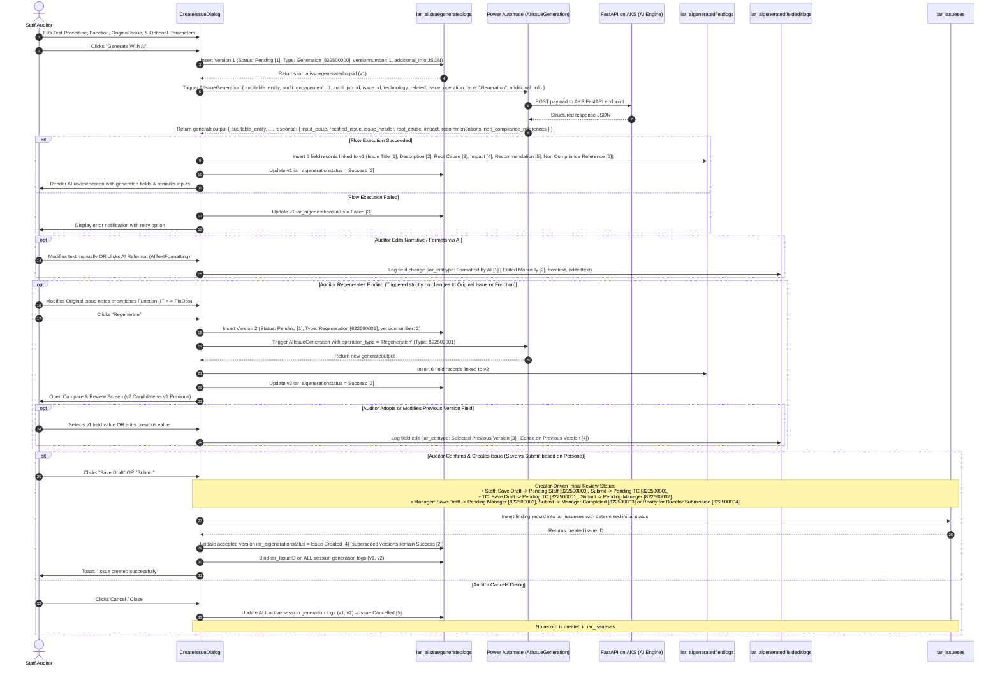
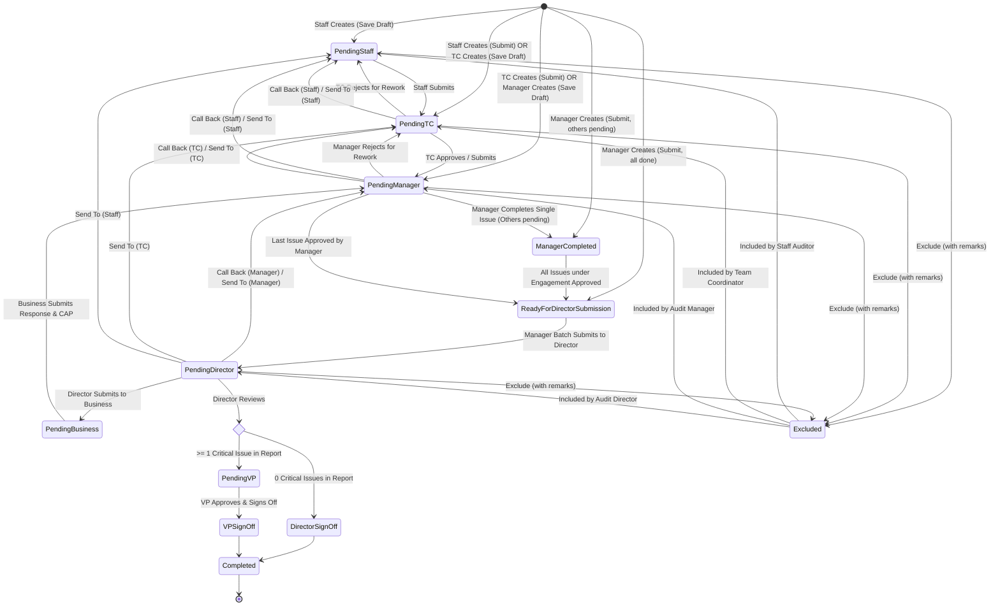
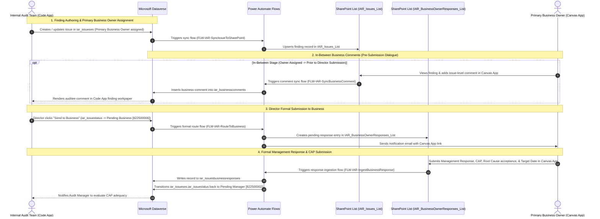

# Functional Requirements Document (FRD)
## IAR Module: Reporting & Finding Governance

---

## 1. Document Control & Objective

| Property | Value |
| :--- | :--- |
| **Document Title** | Functional Requirements Document — Reporting Module |
| **System Name** | Intelligent Audit Reporting (IAR) Platform |
| **Target Architecture** | Power Apps Code App (React/TS), Dataverse, Power Automate, SharePoint, ADLS |
| **Module Scope** | **Reporting Module** (Full End-to-End Implementation) |
| **Reference Sources** | [Backup_JNJ_IAR](file:///d:/IAR/Backup_JNJ_IAR/) (Business Logic), [Backup_IAR-components](file:///d:/IAR/Backup_IAR-components/) (UI System) |

### 1.1 Business Purpose
The **Reporting Module** is the core operational studio of the IAR platform. It facilitates:
1. Aggregating fieldwork observations into formally documented, compliant audit findings.
2. Synthesizing complex findings and recommendations using enterprise AI.
3. Conducting structured multi-tier supervisory reviews across IT and FinOps governance lines.
4. Orchestrating auditee business responses and remediation date commitments.
5. Providing concurrent drafting and executive sign-off for Executive Summary reports.
6. Enforcing strict regulatory compliance (GxP, SOX, ISO, IAPP) with immutable audit logging.

### 1.2 Data Ingestion & Operational Ownership Boundaries
- **Upstream Master Ingestion (Hourly Scheduled Flow)**:
  - Portfolios (`iar_assessments`), Engagements (`iar_engagementses`), Test Procedures (`iar_procedureses`), Assigned Roles (`iar_securityassignmentses`), and Taxonomies (`iar_taxonomiesmasters`, `iar_taxonomieses`) are synchronized automatically via a **Scheduled Power Automate flow executing every 1 hour**.
  - The flow monitors upstream source systems for new or modified records and upserts them into Dataverse.
  - In the Reporting Module UI, these entities are consumed as **read-only master references** (queue displays, workprogram lookups, and auditor assignment resolution).
- **Application-Managed Governance & Execution**:
  - The IAR Code App is the exclusive system of record for finding creation, workpaper narratives, AI synthesis (`iar_aiissuegenerations`), 5-tier review progressions, field-level comments (`iar_issuecomments`), executive summary reports (`iar_executivesummaryreports`), and auditee management responses (`iar_issuesbusinessresponses`).

---


## 2. Multi-Role Governance & Permission Matrix

The Reporting Module enforces strict role-based access control (RBAC) across two primary audit domains (**IT** and **FinOps**) plus case-based **Business Contacts**:

```mermaid
graph TD
    classDef staff fill:#f1f5f9,stroke:#64748b,stroke-width:2px,color:#0f172a;
    classDef tc fill:#eff6ff,stroke:#3b82f6,stroke-width:2px,color:#1e3a8a;
    classDef mgr fill:#fef3c7,stroke:#f59e0b,stroke-width:2px,color:#78350f;
    classDef dir fill:#f3e8ff,stroke:#a855f7,stroke-width:2px,color:#581c87;
    classDef vp fill:#ffe4e6,stroke:#f43f5e,stroke-width:2px,color:#881337;
    classDef biz fill:#e0f2fe,stroke:#0284c7,stroke-width:2px,color:#0369a1;

    STAFF["1. Staff Auditor<br/>(Draft Findings & AI Synthesis)"]:::staff
    TC["2. Team Coordinator (TC)<br/>(Technical & Evidence Review)"]:::tc
    MGR["3. Audit Manager<br/>(Supervisory Review & Batch Submission)"]:::mgr
    DIR["4. Audit Director<br/>(Executive Review & Business Routing)"]:::dir
    BIZ["Business Contact<br/>(Canvas App / SharePoint List)"]:::biz
    VP["5. Vice President (VP)<br/>(Mandatory Gate for Critical Issues)"]:::vp

    STAFF -->|Submit Finding| TC
    TC -->|Approve & Advance| MGR
    MGR -->|Batch Submit All Issues| DIR
    DIR -->|Formally Route Finding for Response| BIZ
    BIZ -->|Submit Management Response & CAP| MGR
    MGR -->|Validate Response & Resubmit to Director| DIR
    DIR -->|Standard Sign-Off (0 Critical)| Done["Engagement Completed"]
    DIR -->|Escalate (>= 1 Critical)| VP
    VP -->|Executive Sign-Off| Done
```

### 2.1 Role Permissions Matrix

| Operational Capability | Staff Auditor | Team Coordinator (TC) | Audit Manager | Audit Director | Vice President (VP) | Business Contact (Canvas App) | Global Audit Admin (`iar_administratorses`) |
| :--- | :---: | :---: | :---: | :---: | :---: | :---: | :---: |
| **Create New Finding / Issue** | ✅ Yes | ✅ Yes | ✅ Yes | ❌ Read Only | ❌ Read Only | ❌ No | ✅ Super-User |
| **Trigger Initial AI Synthesis** | ✅ Yes | ✅ Yes | ✅ Yes | ❌ No | ❌ No | ❌ No | ✅ Super-User |
| **Regenerate & Compare AI Versions** | ✅ Yes | ✅ Yes | ✅ Yes | ❌ No | ❌ No | ❌ No | ✅ Super-User |
| **Edit Workpaper Finding Content** | When `Pending Staff` | When `Pending TC` | When `Pending Manager` | When `Pending Director` | When `Pending VP` | ❌ No | ✅ Super-User (Any Stage) |
| **Submit to Team Coordinator** | ✅ Yes | ❌ N/A | ❌ N/A | ❌ N/A | ❌ N/A | ❌ No | ✅ Yes |
| **Submit to Audit Manager** | ❌ No | ✅ Yes | ❌ N/A | ❌ N/A | ❌ N/A | ❌ No | ✅ Yes |
| **Submit Batch to Director** | ❌ No | ❌ No | ✅ Yes (All issues ready) | ❌ N/A | ❌ N/A | ❌ No | ✅ Yes |
| **Route to Business for Response** | ❌ No | ❌ No | ❌ No (Submits to Director) | ✅ Yes (**Sole Authority**) | ❌ No | ❌ N/A | ✅ Yes |
| **Submit Action Plan & Target Date** | ❌ No | ❌ No | ❌ No | ❌ No | ❌ No | ✅ Yes (Via Canvas App) | ❌ N/A |
| **Verify Business Response & Resubmit** | ❌ No | ❌ No | ✅ Yes | ❌ N/A | ❌ N/A | ❌ No | ✅ Yes |
| **Final Sign-Off (No Critical Issues)**| ❌ No | ❌ No | ❌ No | ✅ Yes | ✅ Yes | ❌ No | ✅ Yes |
| **Final Sign-Off ($\ge 1$ Critical Issue)**| ❌ No | ❌ No | ❌ No | ❌ Blocked | ✅ Mandatory | ❌ No | ✅ Yes |
| **Add Field-Level Comments** | ✅ Yes | ✅ Yes | ✅ Yes | ✅ Yes | ✅ Yes | ✅ Yes (Synced via SP List) | ✅ Yes |
| **Resolve Tagged `@mention` Comment**| Only if tagged | Only if tagged | Only if tagged | Only if tagged / Lead | Only if tagged / Admin | Only if tagged | ✅ Yes (Admin Override) |
| **Cross-Engagement Queue Visibility**| Scoped | Scoped | Scoped | Scoped | Scoped | Scoped (Issue Level) | ✅ Unrestricted Enterprise |

### 2.2 Business Auditee Architecture & Licensing Strategy
1. **Zero Dataverse Premium License Footprint**:
   - Business auditees across enterprise business units do **not** have or require Dataverse Premium licenses.
   - Consequently, Business Contacts do not log into the main IAR Power Apps Code App.
2. **Dedicated Canvas App on SharePoint Dual-List Architecture**:
   - A companion **Power Apps Canvas App** built with standard Microsoft 365 SharePoint licensing serves as the business auditee portal.
   - Operates on two SharePoint Lists:
     - **`IAR_Issues_List`**: System-synchronized mirror of findings from `iar_issueses`, allowing auditees to view issues and post in-between comments prior to formal response request (synced to Dataverse `iar_businesscomments`).
     - **`IAR_BusinessOwnerResponses_List`**: Actionable response queue provisioned upon Director submission to business (`Pending Business`), capturing formal Management Response, CAP, root cause acceptance, and target date.
   - Business Contacts are assigned at the **individual Issue Level** (`iar_issueses`), not through TeamMate engagement assignments.
   - Through the Canvas App, business contacts can:
     - Review assigned findings and workpaper context at any time.
     - Post in-between comments and questions at any time (synced to Dataverse `iar_businesscomments`).
     - Formally author and submit the **Management Response and Corrective Action Plan (CAP)** once the issue is advanced to `Pending Business` by the **Audit Director**.
3. **Bi-Directional Comment & Response Visibility**:
   - In-between comments entered by business contacts sync to Dataverse table `iar_businesscomments`.
   - Formal responses entered in `IAR_BusinessOwnerResponses_List` sync via Power Automate flow `FLW-IAR-IngestBusinessResponse` to Dataverse table `iar_issuesbusinessresponses`.
   - Upon submission of the Management Response, the workflow automatically transitions the finding back to **`Pending Manager`** so the supervisory team can evaluate response adequacy before presenting it to the Director.

### 2.3 Role Resolution & LogicKey Governance Engine
The application enforces dynamic, engagement-scoped role resolution rather than static user roles:
1. **Global Administrator Verification**:
   - On app startup, the app checks whether the user's email exists and is active in `iar_administratorses`.
   - If affirmative, the user receives **Global Audit Administrator** privileges with enterprise-wide visibility across all engagements, bypassing engagement assignment checks.
2. **Engagement Assignment Lookup**:
   - For standard auditors, when opening an engagement, the app queries `iar_securityassignmentses` for records matching `iar_useremailid == currentUser.email` and `iar_EngagementID == currentEngagement.id`.
   - In accordance with business rules, each user has at most one role assigned on an engagement. If an edge case exists where multiple assignment rows are returned, the app automatically grants **cumulative permissions** without requiring a manual role switcher.
3. **User Identity Resolution**:
   - The app maps `iar_useremailid` against `systemusers.internalemailaddress` to retrieve the user's standardized display name (`fullname`), avatar initials, and Dataverse `systemuserid`.
4. **TeamMate Role Join**: The assignment record contains `iar_tmroleid` (e.g. `1`, `5`, `8`). The app joins this value against `iar_tmroleses.iar_tmid`.
5. **LogicKey Resolution**: The app extracts the standardized `LogicKey` (`iar_logickey`):

   - **`ITS`** / **`FIS`**: IT / Financial Audit Staff (Preparer permissions; drafts findings; triggers AI synthesis; submits to TC).
   - **`ITT`** / **`FIT`**: IT / Financial Team Coordinator (Reviewer Tier 1; edits in `Pending TC`; approves & routes to Manager).
   - **`ITM`** / **`FIM`**: IT / Financial Audit Manager (Reviewer Tier 2; edits in `Pending Manager`; evaluates business responses; submits batch to Director).
   - **`ITD`** / **`FID`**: IT / Financial Audit Director (Reviewer Tier 3; edits in `Pending Director`; sole authority to dispatch to Business; signs off standard reports).
   - **`ITV`** / **`FVP`**: IT / Financial Vice President (Reviewer Tier 4; mandatory sign-off authority for engagements with $\ge 1$ Critical issue).
6. **UI Determinism**: Action buttons (`Submit to TC`, `Approve`, `Send for Business Response`, `Sign Off`), drawer controls, and workpaper field editability are conditionally rendered based exclusively on this resolved `LogicKey`.


---


## 3. UI Views & Screen Specifications

The Reporting Module consists of four primary integrated views:

### 3.1 View 1: My Audits (Audit Queue Landing Page)
- **Purpose**: Personalized dashboard and engagement queue where auditors and supervisors access their assigned audits.
- **Header KPI Summary Bar**:
  - Total Engagements Assigned.
  - In Progress Reports count.
  - Completed Reports count.
  - Critical Findings count across active portfolio.
- **Engagement Portfolio Tabs**:
  - `All Audits`
  - `My Active Queue`
  - `Pending My Review` (filtered by active user role)
  - `Completed Audits`
- **Filter & Search Toolbar**:
  - Search by Engagement Name, Report ID (`REP-2026-xxx`), Lead Auditor, or Business Unit.
  - Filter by **Assessment Year** (populated from `iar_assessments`; parsed from `iar_startdate`; strict 1:1 year-to-assessment invariant; defaults automatically to the **current calendar year**; displays **Assessment State** pill badge e.g. `2026` [Open], `2025` [Reopened], `2024` [Finalized] directly on each filter item).
  - Filter by Domain (`IT`, `FinOps`).
  - Filter by Criticality (`Critical`, `Major`, `Moderate`, `Minor`).
- **User Profile Menu & Administrator Capabilities**:
  - Persona switcher & identity indicator in top header.
  - **Impersonate User Option**: For users authenticated as Global Administrators (`iar_administratorses`), the profile menu exposes an **"Impersonate User"** modal/selector. Admins can select any user in the organization to experience the Audit Queue, engagement access, and workflow action buttons precisely as that user sees them.
  - **Active Impersonation Banner**: When impersonating, a high-visibility persistent banner is displayed at the top of the interface: *"You are viewing as [User Name] (Role: [LogicKey]) — [Exit Impersonation]"*.

- **Engagement Card / Table Structure**:
  - Implemented using the standardized [`SharedTable`](file:///d:/IAR/Backup_IAR-components/src/components/shared/SharedTable.tsx) card-row grid layout.
  - **Header Grid Columns**:
    - **Expand Spacer** (`44px` width for accordion chevron).
    - **Engagement** (`iar_engagementname`, e.g. `GS Bogota - Revenue process`). *(Note: There is intentionally no Queue ID / Engagement ID column rendered; the row is headlined directly by the Engagement title).*
    - **Status**: `iar_reportstatus` (`Not Started`, `Audit Report Inprogress`, `Executive Report Inprogress`, `Completed`).
    - **Action Issues** (in "My Actions" tab): Count of findings requiring current user action.
    - **Current Queue**: Review tier bucket (e.g. `Audit Staff`, `Team Coordinator`, `Audit Manager`, `Audit Director`, `Business Review`).
    - **Current Owner**: Resolved from `iar_securityassignmentses`.
      - *Primary Avatar*: In "My Actions" tab, always displays the logged-in user. In "All Associated" tab, displays the logged-in user if they are part of the current queue of any issue in that engagement, or otherwise the first assigned user alphabetically.
      - *Multi-User Popover (`+ more users`)*: Displays all assigned users in alphabetical order, formatting each entry as `[User Name] ([Role Name])` (e.g. `Tamilselvan (IT MGR)`, `Gowri P (FIN DIR)`).
      - *Ownership Model*: All assigned team members are equal; there is no operational distinction between "Lead Auditor" and "Co-owner".

    - **In-Progress** (in "All Associated" tab): Count of unresolved active findings.
    - **Actions**: Dynamic action button container.
  - **Engagement Lifecycle Transitions & Action Buttons**:
    - For engagements in **`Not Started`**, the UI displays two actionable paths:
      - **`+ Create Issue`**: Triggers the Create Finding drawer. As soon as the **first issue is created**, `iar_reportstatus` automatically transitions from `Not Started` $\rightarrow$ **`Audit Report Inprogress`**.
      - **`Work on Executive Summary` (Zero-Issue Reporting Bypass & Standard Review Tier Progression)**: For audits concluding fieldwork with **no negative findings / zero issues**, the Audit Report Studio is **entirely bypassed**. The auditor drafts the Executive Summary directly. Saving or submitting the report transitions `iar_reportstatus` directly from `Not Started` $\rightarrow$ **`Executive Report Inprogress`**. Although the audit report is bypassed, the Executive Summary strictly follows the **standard review tier progression** (`Staff Drafting` $\rightarrow$ `Pending TC` $\rightarrow$ `Pending Manager` $\rightarrow$ `Pending Director` $\rightarrow$ `Pending VP` [if required by policy] $\rightarrow$ `Completed`), guaranteeing rigorous supervisory oversight before final sign-off.
    - For engagements in **`Audit Report Inprogress`**: Row displays `Work on Audit Report`, `Work on Executive Summary`, and `+ Create Issue`.
    - For engagements in **`Executive Report Inprogress`** / **`Completed`**: Row displays `Work on Audit Report` (read-only review once finalized) and `Work on Executive Summary`.

---

### 3.2 View 2: Audit Report Studio (Workpaper Editor)
- **Purpose**: Primary workspace for drafting, refining, reviewing, and approving detailed audit findings.
- **Split Screen / Master-Detail Layout**:
  - **Left Sidebar — Finding Navigator**:
    - List of all issues under the selected engagement.
    - Displays Issue Code (`ISSUE-001`), Test Procedure Badge (`TP-101`), Criticality Chip (`Critical`, `Major`, etc.), and Review Status (`Pending TC`, `Pending Manager`, etc.).
    - **Intuitive Business Comments Indicator**: If business user comments exist for a finding (`iar_businesscomments` count > 0), a high-visibility badge renders directly on the finding card: `💬 Biz Feedback: [count]`. If unread comments exist (`iar_isreadbyauditor === false`), a prominent colored notification dot alerts the auditor that new business auditee feedback has arrived during the drafting/review process.
    - Filter navigator by status and criticality.
    - "+ Add Issue" action button at top of navigator.
  - **Issue Creation & Two-Stage Mandatory Fields Progression (`+ Create Issue` / `+ Add Issue`)**:
    - Triggered from the Audit Queue row or the Finding Navigator header.
    - **Test Procedure Dropdown**: Populated dynamically with active records from `iar_procedureses` strictly scoped to the parent engagement (`"iar_EngagementID@odata.bind"`).
      - *Display Format*: Renders the **simple procedure name** (`iar_procedurename`) without code prefixes.
      - *Cardinality*: A single test procedure can be associated with **multiple findings/issues** within an engagement.
    - **No State Filtering**: Upstream `iar_procedurestate` and `iar_procedurestateid` are pass-through metadata and have **no operational significance**; all active procedures in the engagement are selectable.
    - **Two-Stage Mandatory Fields Progression**:
      - **Stage 1 (Initial Issue Creation in `CreateIssueDialog` / AI Generation)**:
        - ONLY 3 fields are strictly mandatory:
          1. **Test Procedure** (`iar_TestProcedure`)
          2. **Function** (`iar_function`: IT [`822500000`] or FinOps [`822500001`])
          3. **Original Issue** (`iar_originalissue`)
        - All other finding attributes (Primary Business Owner, Criticality, Accountable Function, Process Area, etc.) are **optional** during initial creation.
      - **Stage 2 (Manager Submission Gate)**:
        - Before an issue can advance from Audit Manager review (`Pending Manager` $\rightarrow$ `Ready for Director Submission` / batch submission to Director), the following fields become **strictly mandatory**:
          1. **Primary Business Owner** (`iar_PrimaryBusinessOwner`) — MUST be assigned before leaving Manager tier.
          2. **Criticality** (`iar_criticality`)
          3. **Root Cause** (`iar_rootcause`)
          4. **Impact** (`iar_impact`)
          5. **Recommendations** (`iar_recommendations`)
          6. **Accountable Function** (`iar_AccountableFunction`)
          7. **Accountable Process Area** (Taxonomy)
    - Selecting a procedure binds `"iar_TestProcedure@odata.bind"` on the new finding and seeds AI synthesis context.

  - **Right Panel — Finding Workpaper Editor**:

    - **Header Block**: Issue Title, Test Procedure Reference, Criticality selector, Accountable Process Area, Function, Accountable Function.
      - *`Function` vs. `Accountable Function`*:
        - **`Function`** (`iar_function`): Operational track choice (`IT` [`822500000`] or `FinOps` [`822500001`]). This field is used **exclusively to drive the `technology_related` parameter** (boolean: `true` for IT, `false` for FinOps) when invoking the `AIIssueGeneration` AI flow.
        - **`Accountable Function`** (`iar_AccountableFunction`): A dedicated finding attribute storing the operational business function responsible for the auditable area (taxonomy-driven lookup from `iar_taxonomieses`), completely distinct from the AI invocation track.
      - *Primary Business Owner*: Mapped directly at the issue level (`"iar_PrimaryBusinessOwner@odata.bind"`). Mandatory before Manager submits to Director.
      - *Secondary Business Owners*: Supported via `iar_issuebusinessownerses` (multiple secondary auditees with delegation tracking).
      - *Taxonomy-Backed Dropdowns*: Populated from `iar_taxonomieses` (Process Area, Issue Type, Issue Cause Type, Issue Source, Key Theme, Repeat Finding, IT Asset Accountable Sector, Impacted Region, Impacted Sector, Impacted MRC, Quarter Impacted).
      - *Schema Evolution*: Some UI fields are planned for incremental addition in upcoming schema updates (placed within an "Additional Details" section).
    - **Workpaper Body Sections** (Collapsible via [`SharedAccordion`](file:///d:/IAR/Backup_IAR-components/src/components/shared/SharedAccordion.tsx)):
      1. *Executive Summary of Finding & Detailed Observation*.
      2. *Root Cause Analysis*.
      3. *Business, Financial & Compliance Impact*.
      4. *Audit Recommendations*.
      5. *Mitigating Controls & Interim Safeguards*.
      6. *Applicable Compliance Standards & Policy Citations*.
      7. *Agreed Management Response & Target Remediation Date* (Editable when in `Pending with Business`).
      8. *Intuitive Business Auditee Dialogue & Comments Panel* (Dedicated Section):
         - Seamlessly surfaces all in-between comments submitted by the Primary Business Owner from the companion Canvas App (`iar_businesscomments`).
         - Displays auditee author name, submission timestamp, and comment narrative.
         - Includes an intuitive "Mark as Reviewed" action that clears the unread badge (`iar_isreadbyauditor = true`).
    - **In-Situ Collaboration Trigger**: Every field includes a comment bubble showing unresolved comment counts across all 31 finding fields.
    - **AI Assistance Bar**: Quick action button: `"AI Refine / Regenerate Finding"` to trigger LLM synthesis.
    - **Report Export Format**: Downloadable / printable official audit report is produced exclusively in **PDF Format**.
    - **Bottom Sticky Action Footer & Final Sign-Off**:
      - Status pill showing current queue and reviewer.
      - **Action Buttons Dock**:
        - **`Call Back`**: Standalone button enabling pulling an issue down from an upper-level review with mandatory remarks.
        - **`Send To`**: Standalone button (alongside Call Back) enabling routing to any peer reviewer on the engagement; on click, opens a modal listing all personas and their assigned user names on the engagement.
        - **Persona Lifecycle Actions**: Dynamic primary/secondary transition buttons based on current state (e.g. `Save Draft`, `Submit to TC`, `Approve & Route to Manager`, `Submit to Director`).
        - **`Send to Business`**: Standalone Director-only button visible exclusively to the **Audit Director** upon review completion at `Pending Director` stage to formally dispatch findings to the Business Contact (`Pending Business`).
        - **`Complete and Sign-Off` (Dedicated One-Click Direct Sign-Off Button)**:
          - Appears once all findings reach final review clearance.
          - **Conditional Role Visibility**:
            - **Audit Director**: Possesses the "Complete and Sign-Off" button if there are **0 Critical issues** in the audit report.
            - **Vice President (VP)**: If there is **at least 1 Critical issue** in the report, the button is hidden for Director, the engagement routes to `Pending VP`, and the **VP** possesses the dedicated "Complete and Sign-Off" button.
          - **Direct One-Click Execution (No Remarks or E-Signature Prompt)**:
            - Clicking "Complete and Sign-Off" is a **clean, direct button action**.
            - The action does **not** prompt for remarks or require an electronic signature modal.
            - Clicking the button directly finalizes the Audit Report and automatically transitions engagement `iar_reportstatus` from **`Audit Report Inprogress`** (`822500001`) $\rightarrow$ **`Executive Report Inprogress`** (`822500002`).

### 3.2.1 Audit Report Studio Interactive Operations & Finding Governance
The Audit Report Studio provides a comprehensive set of in-studio finding management tools:

1. **Call Back (with Mandatory Remarks & Persona-Level Pull)**:
   - **Mechanism**: A flexible **PULL** mechanism enabling any persona to recall an issue from any upper-level persona or queue down into their own pending queue.
   - **Review Status Transitions**:
     - **Staff Auditor** calls back (from `Pending TC`, `Pending Manager`, or `Ready for Director Submission`) $\rightarrow$ `iar_issuestatus` transitions to **`Pending Staff`** (`822500000`).
     - **Team Coordinator (TC)** calls back (from `Pending Manager` or `Ready for Director Submission`) $\rightarrow$ `iar_issuestatus` transitions to **`Pending TC`** (`822500001`).
     - **Audit Manager** calls back (from `Pending Director`) $\rightarrow$ `iar_issuestatus` transitions to **`Pending Manager`** (`822500002`).
     - **Audit Director** calls back (from `Pending Business` or `Pending VP`) $\rightarrow$ `iar_issuestatus` transitions to **`Pending Director`** (`822500005`).
   - **Mandatory Reason Prompt**: Triggers the Call Back Modal requiring the user to provide a mandatory justification.
   - **Dual-Storage Reason Logging**:
     - Inserts an immutable row in **`iar_issuelogses`** (`iar_logtype: 2` `Workflow`, `iar_logsubtype: 2` `Call Back`, `iar_fromdata: [Previous Status]`, `iar_todata: [Calling Persona Status]`, `iar_workflowremarks: [Reason]`).
     - Updates operational field **`iar_issueses.iar_workflowremarks`** with the callback reason so the workpaper card banner displays the recall context instantly.

2. **Send To vs. Send to Business (Two Distinct Features)**:
   - **`Send To` (Standalone Button for Peer Handover)**:
     - Rendered as a dedicated action button alongside `Call Back`.
     - **Engagement-Scoped Recipient Selection**: On click, opens the "Send To" modal listing **only users assigned to the current engagement** in `iar_securityassignmentses`, displaying their persona role and full name (e.g. `Staff Auditor — Tamilselvan`, `Team Coordinator — Gowri P`, `Audit Manager — Amanda Palmer`, `Audit Director — Marcus Vance`).
     - **Status Progression & Current Owner Update**:
       - Transitions `iar_issuestatus` to the target persona's pending review stage (`Pending Staff` [`822500000`], `Pending TC` [`822500001`], `Pending Manager` [`822500002`], `Pending Director` [`822500005`]).
       - Updates finding ownership: binds `"iar_CurrentOwner@odata.bind"` on `iar_issueses` to the selected recipient's `systemusers` record (`systemusers(guid)`).
     - **Mandatory Remarks**: Requires the sending auditor to input detailed handover instructions / notes in `iar_workflowremarks`.
     - **Dual-Storage Logging**: Writes to **`iar_issuelogses`** (`iar_logtype: 2` `Workflow`, `iar_logsubtype: 3` `Send To`, `iar_fromdata: [Previous Status]`, `iar_todata: [Target Persona Status]`, `iar_workflowremarks: [Remarks]`) and updates `iar_issueses.iar_workflowremarks`.
   - **`Send to Business` (Director-Only Review Completion Action)**:
     - An entirely separate governance action reserved **exclusively for the Audit Director**.
     - Visible only when the issue is under Director review (`Pending Director`).
     - Formally routes the finding to the Business Contact (`Pending Business` [`822500006`]) via the Canvas App connected to SharePoint.

3. **Include & Soft Exclude Findings (Status `822500009: Excluded` — Strictly NO Permanent Deletion)**:
   - **Strictly No Permanent Deletion**: Findings are **never permanently deleted** from the system under any circumstances. GxP / SOX regulatory non-repudiation mandates that all recorded observations remain historically traceable. Deletion is replaced entirely by soft exclusion.
   - **Explicit Choice in `iar_issuestatus`**: Excluded issues are formally represented by choice value **`822500009` $\rightarrow$ `Excluded`** in the `iar_issuestatus` OptionSet.
   - **Exclusion Workflow**:
     - Clicking **"Mark Exclude Issue"** opens a modal to input the reason for exclusion.
     - Sets `iar_issuestatus` to **`822500009`** (`Excluded`).
     - Updates **`iar_issueses.iar_workflowremarks`** with the exclusion rationale.
     - Logs to **`iar_issuelogses`** (`iar_logtype: 2` `Workflow`, `iar_logsubtype: 5` `Exclude`, `iar_fromdata: [Previous Status]`, `iar_todata: 'Excluded'`, `iar_workflowremarks: [Exclusion Reason]`).
     - In the UI, the finding is softly disabled; all input fields become read-only, title is rendered struck-through with an `EXCLUDED` badge, and an amber banner appears: *"This finding has been softly excluded from the audit report: [Reason]. Do you want to include?"*.
   - **Exclusion Batch Exemption Rule (Manager to Director Batch Progression)**:
     - Once an issue is excluded, it is treated as soft-deleted and removed from report compilation.
     - **Workflow Non-Interference**: Sibling issue completion checks for advancing from `Pending Manager` to `Ready for Director Submission` **are NOT blocked or influenced by excluded issues**.
     - The batch completion evaluation considers strictly the remaining **active, non-excluded findings** under the engagement. If all active non-excluded issues are completed by the Manager, the batch immediately advances to **`Ready for Director Submission`** (`822500004`).
   - **Persona-Based Re-Inclusion Workflow**:
     - When any auditor clicks **"Include Issue in Report"**, the finding transitions directly to **Pending with that Persona**:
       - If **Staff Auditor** includes $\rightarrow$ `iar_issuestatus` transitions to **`Pending Staff`** (`822500000`).
       - If **Team Coordinator (TC)** includes $\rightarrow$ `iar_issuestatus` transitions to **`Pending TC`** (`822500001`).
       - If **Audit Manager** includes $\rightarrow$ `iar_issuestatus` transitions to **`Pending Manager`** (`822500002`).
       - If **Audit Director** includes $\rightarrow$ `iar_issuestatus` transitions to **`Pending Director`** (`822500005`).
     - Prompts for reinstatement remarks.
     - Logs to **`iar_issuelogses`** (`iar_logtype: 2` `Workflow`, `iar_logsubtype: 10` `Include`, `iar_fromdata: 'Excluded'`, `iar_todata: [New Pending Status]`, `iar_workflowremarks: [Remarks]`).
     - Updates **`iar_issueses.iar_workflowremarks`**.

4. **Mark Not My Function Issue (Track Switch IT $\leftrightarrow$ FinOps)**:
   - **Mechanism**: Re-assigns the finding's operational domain track by toggling the `iar_function` column in `iar_issueses`:
     - If current `iar_function` is **`IT`** (`822500000`), it changes to **`FinOps`** (`822500001`).
     - If current `iar_function` is **`FinOps`** (`822500001`), it changes to **`IT`** (`822500000`).
   - **Review Status Preservation**: The finding stays at its current review status (e.g. `Pending TC` remains `Pending TC`), but responsibility transitions to the peer domain auditor/team.
   - **Reason Capture**: Auditor inputs explanation of why the finding belongs to the other track.
   - **Logging**: Writes to **`iar_issuelogses`** (`iar_logtype: 2` `Workflow`, `iar_functiontype: 2` `Scope Modified`, `iar_fromdata: [Old Function]`, `iar_todata: [New Function]`, `iar_workflowremarks: [Remarks]`). Updates `iar_issueses.iar_workflowremarks`.

5. **Reason & Remarks Storage Architecture**:
   - **Historical Audit Trail (`iar_issuelogses.iar_workflowremarks`)**: Native Dataverse column (Multiple Lines of Text) preserving an immutable GxP record of every action, user, timestamp, prior state, new state, and rationale.
   - **Active Operational State (`iar_issueses.iar_workflowremarks`)**: Recommended operational column on `iar_issueses` holding the most recent workflow reason/remark (exclusion reason, call back reason, send to instruction). Enables instant rendering of contextual banners on finding cards and queue rows without requiring secondary OData log queries.

6. **Workflow Submissions (with Remarks)**:
   - All standard status advancements (`Submit to TC`, `Submit to Manager`, `Submit to Director`, `Send for Business Response`) support entering reviewer remarks stored in `iar_issuelogses.iar_workflowremarks` and `iar_issueses.iar_workflowremarks`.

7. **Team Member Edit Permissions & Automatic Inactivity-Aware Soft Locking (Auto-Unlock on Inactivity)**:
   - **Editability Across All Pending Tiers**: Any team member assigned to the engagement can edit finding fields during any active `Pending` status (`Pending Staff`, `Pending TC`, `Pending Manager`, `Pending Director`). Findings are not restricted to only the current queue holder, fostering agile collaboration across the audit team. (Exceptions: Excluded findings or `Pending Business` where internal audit edits are paused).
   - **Implicit Event-Driven Lock Acquisition (NO Manual Lock Button)**:
     - Record locking is **not a manual user button action**; it is triggered automatically when a user starts active work.
     - As soon as any team member **actively starts editing** an issue (e.g. focuses an input field, begins typing, or enters an editable section in the workpaper):
       - The system automatically acquires the soft record lock: updates Dataverse setting `iar_issueses.iar_lockstatus = true` and binds `"iar_LockedBy@odata.bind"` to that user's `systemusers` record.
       - Logs the lock event to `iar_issuelogses` (`iar_logsubtype: 4` `Locking`).
   - **Real-Time Lockout for Concurrent Viewers**:
     - For all **other users** viewing or opening the issue simultaneously:
       - All workpaper fields (text areas, dropdowns, inputs) become strictly read-only and disabled.
       - All workflow transition buttons (`Submit`, `Send To`, `Call Back`, etc.) are completely disabled.
       - A persistent, high-visibility informational lock banner is displayed: *"🔒 Currently being edited by [User Name] — changes are locked for other users"*.
       - Polling or tab-focus listeners check lock status in the background to detect when the record becomes free.
   - **Instant Re-enabling Upon Normal Exit**:
     - Once the current editing user finishes or leaves, other users are immediately enabled to work on the issue:
       1. **Workflow Submit**: Formal submission transitions automatically clear the lock (`iar_lockstatus = false`, `"iar_LockedBy@odata.bind"` set to `null`).
       2. **Cancel or Discard**: Clicking Cancel/Discard immediately releases the lock.
       3. **Navigating Away**: Switching to another finding card in the Finding Navigator, returning to the Audit Queue, or navigating to another phase triggers a cleanup hook that immediately releases the lock.
       4. **Browser Tab / Window Close**: Window `beforeunload` lifecycle listener sends an unlock beacon to release the lock immediately.
   - **Inactive Mode & 1-Hour Automatic Unlock Watchdog (1-Hour Idle Auto-Unlock)**:
     - If the editing user walks away from their desk, gets distracted, or stops interacting with the application:
       - The Code App runs a client-side inactivity timer monitoring user events (`keydown`, `mousedown`, `mousemove`, `scroll`, `input`).
       - If no user activity is detected for **59 minutes**:
         - A prominent modal alert appears with a 60-second grace countdown: *"⚠️ You have been inactive for 59 minutes. To allow other team members to edit this finding, your session will automatically unlock in 60 seconds unless you continue working."*
         - If the user moves the mouse, presses any key, or clicks "Keep Working", the inactivity timer resets.
       - If the user remains inactive past the countdown (reaching **1 hour** of total inactivity):
         - The application **automatically releases the lock**: calls Dataverse to set `iar_lockstatus = false` and `"iar_LockedBy@odata.bind" = null`.
         - The editing user's screen is reverted to read-only view.
         - The finding is instantly unlocked, and other team members are immediately enabled to edit.
   - **Server-Side Deadlock Resilience (Lease Expiry Safety Net)**:
     - If a user closes their laptop lid without internet or their browser process crashes suddenly (preventing client-side unlock dispatch):
       - When another user opens a locked issue, if the lock was acquired > 1 hour ago without an active heartbeat, the system evaluates the lock as **stale/expired**.
       - The stale lock is automatically evicted/overridden, allowing the active user to acquire editing rights without requiring manual IT admin intervention.
   - **Audit Report Workpaper Debounced Auto-Save (Manual Submissions Only)**:
     - **Continuous Auto-Save**: On the Audit Report page workpapers, all finding field modifications (narratives, dropdowns, references) are **automatically saved (auto-saved)** to Dataverse via debounced updates (1.5s–2s) as the auditor edits.
     - **Visual Auto-Save Status Indicator**: A non-intrusive status pill is rendered in the workpaper header toolbar:
       - 🔄 *"Saving changes..."* (during active debounced PATCH to Dataverse).
       - ☁️ *"All changes saved"* or *"Saved at [HH:MM:SS]"* (upon successful Dataverse response).
       - ⚠️ *"Error saving changes — Retrying..."* (if network disconnect occurs).
     - **Manual Submissions Only**: All formal workflow advancements (`Submit to TC`, `Submit to Manager`, `Batch Submit to Director`, `Send to Business`, `Complete and Sign-Off`) remain **strictly manual** and require clicking the explicit action button with reviewer remarks.
     - **GxP Audit Trail Logging Strategy**: To prevent database bloat and audit trail log pollution from high-frequency typing keystroke saves, GxP field-level audit trail logs in `iar_issuelogses` (`iar_logtype: 3 Field Edits`) are emitted upon **Field Blur** (when the user finishes editing a specific field and clicks/tabs away) or upon workflow submission, rather than on every raw debounced micro-save.

8. **In-Studio AI Re-Synthesis & Version Comparison**:
   - Quick action bar enables re-invoking `AIIssueGeneration` on fieldwork notes or function changes.
   - Side-by-side comparison modal displays Candidate vs. Previous versions, allowing granular field-level adoption and tracking in `iar_aigeneratedfieldeditlogses`.

9. **Finding Re-ordering & Ref Numbering (with Warning)**:
   - Auditors can drag or re-sequence findings within the Finding Navigator.
   - Re-ordering re-calculates the official report reference numbers (`iar_reportreference`, e.g. `1`, `2`, `3`...) and updates sequence indexes (`iar_issuelogses.iar_orderbyauditreport`).
   - **Reorder with Warning Dialog**: Re-ordering triggers a confirmation modal: *"Re-ordering will update the report reference numbers across all findings in this audit report. Do you want to proceed?"*. Especially when re-ordering cross-priority issues (e.g. moving a Major finding ahead of a Critical finding), a priority alignment warning is displayed.

---

### 3.3 View 3: Executive Summary Report Studio
- **Purpose**: High-level synthesis report delivered to Audit Committee, VP, and Board.
- **Concurrency Principle**: Can be drafted and reviewed **in parallel** with the detailed Audit Report.
- **Core Sections**:
  1. **Assessment Objective, Scope & Period**:
     - **Assessment Period**: Dynamically populated from parent `iar_assessments.iar_assessmenttitle` (e.g. `2026 Internal Audit Assessment`).
     - High-level audit boundaries, facilities covered, systems audited.
  2. **Operational Process Scope Matrix**: Multi-column matrix listing Process Areas, Control Adequacy, and Severity Counts (Critical, Major, Moderate, Minor).
  3. **Key Audit Insights & Executive Narrative**: AI-consolidated executive summary highlighting systemic risks.
  4. **Critical Finding Highlights**: Direct summary cards of any Critical or Major findings elevated from the Audit Report.
  5. **Review & Sign-Off Block & Report Finalization**:
     - **Multi-Tier Review Progression**: Executive Summary authoring and clearance follows the **standard review tier progression** (`Drafting` $\rightarrow$ `Pending TC` $\rightarrow$ `Pending Manager` $\rightarrow$ `Pending Director` $\rightarrow$ `Pending VP` / `Completed`), both for findings-driven audits and for zero-issue audits.
     - **Dedicated One-Click Direct Sign-Off Button**:
       - **Audit Director**: Has the dedicated "Complete and Sign-Off" button if there are **0 Critical issues** in the engagement.
       - **Vice President (VP)**: If there is **$\ge 1$ Critical issue** in the engagement, the final sign-off escalates to the VP, who has the dedicated "Complete and Sign-Off" button.
     - **Direct One-Click Execution (No Remarks or E-Signature Prompt)**:
       - Clicking "Complete and Sign-Off" is a **clean, direct button action**.
       - It does **not** prompt for remarks or require an electronic signature confirmation modal.
     - **Engagement Lifecycle Finalization**:
       - Clicking "Complete and Sign-Off" on the Executive Summary marks the engagement reporting as finished and transitions `iar_reportstatus` from **`Executive Report Inprogress`** (`822500002`) $\rightarrow$ **`Completed`** (`822500003`).
     - **Report Export Format**: Downloadable / printable official executive summary report is produced exclusively in **PDF Format**.


---

### 3.4 View 4: Cross-Engagement Audit Issues View
- **Purpose**: Comprehensive data grid of all individual findings across all annual engagements.
- **Features**:
  - Multi-column sortable grid via [`SharedTable`](file:///d:/IAR/Backup_IAR-components/src/components/shared/SharedTable.tsx).
  - Bulk filter by Test Procedure, Lead Auditor, Remediation Date, and Status.
  - Quick Drawer preview of any finding upon row selection.

---

## 4. Detailed Functional Workflows

### 4.1 AI Architecture & Dual-Capability Synthesis Lifecycle

The application integrates an enterprise AI engine built using **FastAPI microservices deployed in Azure Kubernetes Service (AKS)** by the centralized AI team. These high-performance endpoints are exposed to the Code App through Microsoft Power Automate flows:

1. **Issue Generation & Regeneration Flow (`AIIssueGeneration`)**: Generates or regenerates comprehensive structured finding fields from auditor fieldwork notes.
2. **Field-Level Text Formatting Flow (`AITextFormatting`)**: Formats, condenses, refines tone, or bulletizes text at the individual field level, driven by instructions from `iar_aiformattingcontexts`.



#### Detailed Create Issue & AI Lifecycle Specification:
1. **Dialog Step 1 — Initial Observation & Parameters**:
   - Auditor fills mandatory fields:
     - **Test Procedure**: Scoped to current engagement from `iar_procedureses`.
     - **Function**: Selected as `'IT'` (`822500000`) or `'FinOps'` (`822500001`). Note: This value specifically determines the AI flow parameter `technology_related` (boolean `true` for IT, `false` for FinOps). It is strictly distinct from the **Accountable Function** taxonomy attribute.
     - **Original Issue**: Auditor fieldwork notes and initial observation.
   - Auditor fills optional fields if known (Criticality, Repeat Finding, SOX Reportable, Process Area, Accountable Function, Root Cause Type).
   - Auditor clicks **"Generate With AI"**.
2. **Step 2 — Initial Log Creation in `iar_aiissuegeneratedlogses`**:
   - Record created with:
     - `"iar_EngagementID@odata.bind"`: Foreign key to parent engagement.
     - `iar_versionnumber`: `1` (sequential version number).
     - `iar_type`: `822500000` (`Generation`).
     - `iar_function`: `822500000` (`IT`) or `822500001` (`FinOps`).
     - `iar_originalissue`: User-entered text in the *Original Issue* input.
     - `iar_additionalinformation`: Serialized key-value JSON text capturing optional fields.
     - `iar_aigenerationstatus`: `1` (`Pending`).
3. **Step 3 — Flow Execution (`AIIssueGeneration`)**:
   - Input mapping (via refreshed swagger schema):
     - `auditable_entity` (`text`): Engagement Name (`iar_engagementname`)
     - `audit_engagement_id` (`text_1`): Engagement ID
     - `audit_job_id` (`text_2`): Engagement ID with Date and Time (`${engagementId}_${Date.now()}`)
     - `issue_id` (`text_3`): Current `iar_aiissuegeneratedlogsid`
     - `technology_related` (`boolean`): Boolean `true` if `Function === 'IT'`, else `false`
     - `issue` (`text_4`): Original issue text
     - `operation_type` (`text_5`): `"Generation"` (or `"Regeneration"`)
     - `additional_info` (`text_7`): Serialized JSON string from `iar_additionalinformation`
4. **Step 4 — Output Parsing & Field Logging in `iar_aigeneratedfieldlogses`**:
   - Output received via `generateoutput` text property containing response JSON:
     - `response.issue_header` $\rightarrow$ `iar_fieldname: 1` (`Issue Title`)
     - `response.rectified_issue` $\rightarrow$ `iar_fieldname: 2` (`Description`)
     - `response.root_cause` $\rightarrow$ `iar_fieldname: 3` (`Root Cause`)
     - `response.impact` $\rightarrow$ `iar_fieldname: 4` (`Impact`)
     - `response.recommendations` $\rightarrow$ `iar_fieldname: 5` (`Recommendation`)
     - `response.non_compliance_references` $\rightarrow$ `iar_fieldname: 6` (`Non Compliance Reference`, received as JSON value)
   - Parent log status updated:
     - On success: `iar_aigenerationstatus: 2` (`Success`).
     - On error: `iar_aigenerationstatus: 3` (`Failed`).
5. **Step 5 — AI Review Screen, Field Remarks & Text Reformatting**:
   - Synthesized fields render in the dialog review screen.
   - **Auditor Remarks Storage**: Auditor can enter field-level feedback in `iar_remark`. These remarks are stored in Dataverse for the enterprise AI prompt engineering team to analyze and fine-tune model prompts over time. Remarks are **not** sent to instant regeneration.
   - **AI Reformatting**: Auditor can select reformatting options (loaded from `iar_aiformattingcontextses`) on individual fields. Invokes `AITextFormatting` flow, writes telemetry into `iar_aiformattedlogses`, and logs edit into `iar_aigeneratedfieldeditlogses` (`iar_edittype: 1` `Formatted by AI`).
   - **Manual Edits**: Any manual text revisions before or after creation log to `iar_aigeneratedfieldeditlogses` (`iar_edittype: 2` `Edited Manually`).
6. **Step 6 — Sequential Regeneration & Version Comparison**:
   - **Regeneration Trigger Condition**: Regeneration is triggered **strictly by modifications to Original Issue notes or Function selection** (IT vs. FinOps).
   - Clicking **"Regenerate"**:
     - Inserts a new record into `iar_aiissuegeneratedlogses` (`iar_versionnumber: 2`, `iar_type: 822500001` `Regeneration`, `iar_aigenerationstatus: 1` `Pending`).
     - Invokes flow `AIIssueGeneration` passing `operation_type: "Regeneration"` and `text_5: "Regeneration"`.
     - Creates 6 new field rows in `iar_aigeneratedfieldlogses` linked to the v2 generation log.
     - Updates v2 status to `2` (`Success`).
     - Renders comparison modal allowing side-by-side evaluation between Candidate (v2) and Previous (v1).
     - When the auditor adopts a field from the previous version, or edits an adopted field, it logs to `iar_aigeneratedfieldeditlogses` (`iar_edittype: 3` `Selected Previous Version` or `4` `Edited on Previous Version`).
7. **Step 7 — Final Disposition, Status Progression & Finding Creation**:
   - **On Create Issue (Creator-Driven Initial Review Status)**:
     - When finalizing finding creation via **Save Draft** or **Submit**, the finding is inserted into `iar_issueses` with an initial review status determined by the creator's role and action:
       - **Staff Auditor Creator**:
         - **Save Draft**: Initial status is **`Pending Staff`** (`822500000`).
         - **Submit**: Initial status is **`Pending TC`** (`822500001`) (routes directly to Team Coordinator).
       - **Team Coordinator (TC) Creator**:
         - **Save Draft**: Initial status is **`Pending TC`** (`822500001`).
         - **Submit**: Initial status is **`Pending Manager`** (`822500002`) (routes directly to Audit Manager).
       - **Audit Manager Creator**:
         - **Save Draft**: Initial status is **`Pending Manager`** (`822500002`).
         - **Submit**: Evaluates the status of all other findings under the same engagement:
           - If other findings under the engagement are still pending: Initial status is **`Manager Completed (Waiting for Other Issues)`** (`822500003`).
           - If all other findings under the engagement are completed by Manager: Sibling batch transitions to **`Ready for Director Submission`** (`822500004`).
     - Updates the accepted generation log to `iar_aigenerationstatus: 4` (`Issue Created`).
     - Any superseded generation logs (e.g. v1) remain `2` (`Success`) to preserve historical validity.
     - **All** generation version logs for the draft session (v1, v2) bind `"iar_IssueID@odata.bind"` to the newly created issue GUID.
   - **On Cancel**:
     - All generation logs created during the session (v1, v2) update to `iar_aigenerationstatus: 5` (`Issue Cancelled`).
     - No finding record is created in `iar_issueses`.
8. **Extensibility & Schema Evolution**:
   - Additional operational fields and non-compliance reference columns in Dataverse are being provisioned upstream; `additional_info` JSON buffering and robust parsing guarantee forward compatibility. Non-compliance reference data is ingested as a structured JSON object.


---

### 4.2 Issue Review State Machine & Criticality Escalation



#### State Transition Rules:
1. **`Pending Staff` (`822500000`)**: Initial drafting stage. Accessible when created and saved by Staff Auditor, called back by Staff, sent to Staff, or re-included by Staff Auditor.
2. **`Pending TC` (`822500001`)**: Team Coordinator review tier. Reached when Staff submits, when TC creates and saves draft, when called back by TC, when sent to TC, or when re-included by TC. TC validates workprogram alignment and evidence sufficiency.
3. **`Pending Manager` (`822500002`) & Mandatory Field Submission Gate**:
   - Supervisory review by Audit Manager. Reached when TC submits, when Manager creates and saves draft, when Business Contact submits response & CAP, when called back by Manager, when sent to Manager, or when re-included by Manager.
   - **Manager Submission Gate**: Before the Manager can submit findings forward (`Manager Completed` / `Ready for Director Submission`), the system strictly enforces the mandatory fields gate:
     - **Primary Business Owner** (`iar_PrimaryBusinessOwner`) must be selected.
     - **Criticality**, **Root Cause**, **Impact**, **Recommendations**, **Accountable Function**, and **Process Area** must be fully specified.
4. **`Manager Completed (Waiting on Other Issues)` (`822500003`)**: Set when a Manager completes/approves an issue while sibling active issues in the same engagement are still pending review.
5. **`Ready for Director Submission` (`822500004`) & Exclusion Batch Exemption**:
   - When all active non-excluded issues under an engagement reach Manager completion, the batch transitions to `Ready for Director Submission`.
   - **Exclusion Batch Exemption**: Excluded issues (`822500009`) are treated as soft-deleted and **do NOT influence or block** this batch transition. If all remaining active findings are approved by the Manager, the batch immediately advances to `Ready for Director Submission`.
6. **`Pending Director` (`822500005`)**: Executive clearance tier. Reached when Manager batch-submits, when called back by Director, when sent to Director, or when re-included by Director.
7. **`Pending Business` (`822500006`) & Send to Business Action**:
   - Submitted exclusively by the **Audit Director** upon review completion via the **"Send to Business"** action.
   - Findings route to the Business Contact via the dedicated Canvas App connected to SharePoint (`IAR_BusinessOwnerResponses_List`). Form is locked from internal audit edits while with business.
8. **Post-Response Review**: When the Business Contact submits the response & CAP, the issue returns to **`Pending Manager`** for adequacy evaluation before returning to the Director.
9. **`Excluded` (`822500009`) — Strictly Soft Exclusion (No Permanent Deletion)**: Finding is softly excluded from report compilation. All issue inputs become read-only with an amber exclusion banner. Clicking **"Include Issue in Report"** restores the finding directly into **`Pending with [Persona performing include]`**. Permanent deletion is strictly prohibited.
10. **Interactive Pull & Routing (Call Back vs. Send To)**:
    - **Call Back**: Standalone pull action recalling an issue from any higher level down to `Pending with [Calling Persona]` with mandatory reason.
    - **Send To**: Standalone routing action displaying a modal with **all personas and their assigned user names** on the engagement, allowing the user to select the exact recipient and route the issue to `Pending [Target Persona]` with mandatory instructions.
11. **Criticality Gate & Dedicated Complete and Sign-Off Buttons**:
    - **Audit Report Stage**:
      - If **0 Critical issues** in the engagement: The **Audit Director** holds the dedicated **"Complete and Sign-Off"** button on the Audit Report Studio.
      - If **$\ge 1$ Critical issue** in the engagement: Director clearance routes the audit report to the **Vice President (VP)** (`Pending VP` [`822500007`]), and the **VP** holds the dedicated **"Complete and Sign-Off"** button.
      - **Lifecycle Transition**: Clicking Audit Report "Complete and Sign-Off" finalizes the audit report and automatically advances engagement status `iar_reportstatus` from **`Audit Report Inprogress`** (`822500001`) $\rightarrow$ **`Executive Report Inprogress`** (`822500002`).
    - **Executive Report Stage**:
      - Similarly, the dedicated **"Complete and Sign-Off"** button on the Executive Report Studio is held by the **Audit Director** (if 0 Critical issues) or **Vice President** (if $\ge 1$ Critical issue).
      - **Lifecycle Transition**: Clicking Executive Report "Complete and Sign-Off" finalizes the entire audit engagement reporting, transitioning `iar_reportstatus` from **`Executive Report Inprogress`** (`822500002`) $\rightarrow$ **`Completed`** (`822500003`).

---

### 4.3 Field-Level Collaboration & Strict Resolution Governance

Findings feature granular, in-situ commenting across all 31 finding fields backed by `iar_issuecommentses`:

#### Comment Types & Resolution Governance:
1. **Non-Tagged Comments (General Collaboration)**:
   - For open questions, general wording refinements, or policy citations without targeting an individual.
   - **Resolution Rule**: Can be resolved and marked as done ("Mark as Done") by **any user assigned to the engagement** in `iar_securityassignmentses`.
2. **Tagged Person Comments (`@mention`)**:
   - Created when tagging a specific team member (e.g. `@Amanda Palmer`).
   - **Strict Resolution Lock Rule**: **ONLY the tagged individual** is permitted to resolve and mark the comment as done ("Mark as Done"). For all other users, the resolution button is strictly disabled with a lock indicator:
     > *"Assigned to [Tagged User] — only the tagged recipient can resolve this comment."*
   - **Administrative Override**: Global Administrators (`iar_administratorses`) or Audit Director can override with mandatory logged justification.

---

### 4.4 SharePoint Dual-List Architecture & Business Response Loop

To eliminate enterprise-wide Dataverse Premium licensing costs for Business Auditees, business collaboration is bridged via a dedicated **Power Apps Canvas App connected to two SharePoint Online Lists**:



#### Dual-List Specifications:
1. **`IAR_Issues_List` (SharePoint Issues List)**:
   - **Role**: Read-only finding visibility mirror for Business Contacts.
   - **Sync Behavior**: Whenever an issue is created or modified in the Code App (`iar_issueses`), an automated Power Automate flow synchronizes the changes into this list.
   - **In-Between Comments & Intuitive UI Indication**: Between the time a Primary Business Owner is assigned to an issue and when the Audit Director formally advances it to `Pending Business`, the Business Owner can view the finding in the Canvas App and post **issue-level comments**. These comments trigger an instant flow that writes into Dataverse table **`iar_businesscomments`**. In the Code App, an intuitive visual badge (`💬 Biz Feedback: [count]`) on the Finding Navigator card and a dedicated **"Business Auditee Dialogue & Comments"** workpaper panel immediately surface these comments to the audit team in real time.
2. **`IAR_BusinessOwnerResponses_List` (SharePoint Business Owner Response List)**:
   - **Role**: Actionable formal response queue for Business Auditees.
   - **Creation Trigger**: When the Audit Director clicks **"Send to Business"**, a record is inserted into `IAR_BusinessOwnerResponses_List` assigned to the Primary Business Owner.
   - **Response Submission**: The Business Owner opens the Canvas App, enters their formal **Management Response**, **Root Cause acceptance**, **Corrective Action Plan (CAP)**, and **Target Implementation Date**, and clicks Submit.
   - **Dataverse Ingestion & Return Loop**: An automated event flow (`FLW-IAR-IngestBusinessResponse`) captures the submission, inserts a row into Dataverse table **`iar_issuesbusinessresponses`**, and automatically updates the issue status in `iar_issueses` back to **`Pending Manager`** (`822500002`) for supervisory validation.

---

## 5. Non-Functional & Compliance Requirements

1. **GxP / SOX Compliance Audit Logging**:
   - Every status transition, AI adoption, field modification, and sign-off must generate an immutable entry in `cr_audit_trail_log`.
   - Stored attributes: `log_id`, `entity_name`, `record_id`, `action_type`, `previous_state`, `new_state`, `user_id`, `user_role`, `timestamp`, `ip_client`.
2. **Data Concurrency & Record Locking**:
   - When a user opens an issue in edit mode, a soft record lock (`isLocked`, `lockedBy`, `lockedAt`) is placed to prevent concurrent overwrite collisions.
   - Locks automatically release after 1 hour of inactivity or upon exit. Continuous debounced auto-save ensures work is continuously persisted.
3. **Accessibility & Responsive Standards**:
   - Minimum WCAG 2.1 AA compliance across all Power Apps Code App screens.
   - Seamless scaling across 1080p, 1440p, and laptop resolutions (1366x768 minimum viewport).
