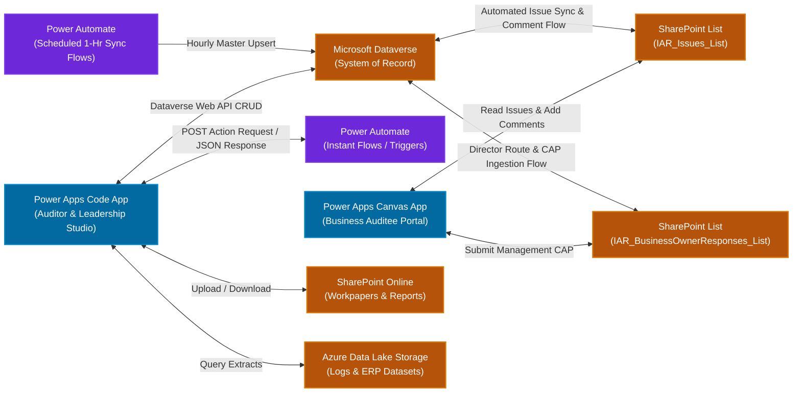

# Integration & Automation Specification (Foundational)
## Power Automate, SharePoint & Azure Data Lake Storage (ADLS)

---

## 1. Executive Purpose & Architecture Overview

This document defines the foundational integration contracts, automation triggers, and storage pathways connecting the **Power Apps Code App** with external Microsoft Power Platform services:



*(Note: Detailed JSON schema contracts, security authentications, and error handling policies will be expanded in a subsequent phase).*

---

## 2. Power Automate: Instant / Logic Flow Catalog

### 2.1 AI Service Architecture: AKS & FastAPI Backend
The enterprise AI engine is engineered using **FastAPI** microservices deployed on **Azure Kubernetes Service (AKS)** by the centralized AI Engineering team. These high-performance REST endpoints are encapsulated inside enterprise Power Automate Logic Flows, allowing the Power Apps Code App to trigger AI capabilities seamlessly with managed enterprise credentials, network security, and rate limiting.

### 2.2 Active Logic Flows Catalog (Power Apps CLI Connected)

| Flow Identifier / Name | Flow GUID / Logicflow | Triggering Event in UI | Input Payload Summary | Target Output / Flow Response | Dataverse Logging & Context Tables |
| :--- | :--- | :--- | :--- | :--- | :--- |
| Flow Identifier / Name | Flow GUID / Logicflow | Triggering Event in UI | Input Payload Summary | Target Output / Flow Response | Dataverse Logging & Context Tables |
| :--- | :--- | :--- | :--- | :--- | :--- |
| **`AIIssueGeneration`** | `dc7339ee-68c1-f111-b377-7c1e520e2b9b` | "Generate with AI" / "Regenerate" in Create/Edit Issue dialog | • `auditable_entity` (`text`): Engagement Name (`iar_engagementname`)<br/>• `audit_engagement_id` (`text_1`): Engagement ID<br/>• `audit_job_id` (`text_2`): ID with Date/Time (`${id}_${timestamp}`)<br/>• `issue_id` (`text_3`): `iar_aiissuegeneratedlogsid`<br/>• `technology_related` (`boolean`): Boolean (`true` for IT, `false` for FinOps)<br/>• `issue` (`text_4`): Original issue narrative<br/>• `operation_type` (`text_5`): `"Generation"` \| `"Regeneration"`<br/>• `additional_info` (`text_7`): Serialized key-value JSON string of all non-mandatory fields (Criticality, SOX, Process Area, Root Cause Type) | `generateoutput` (JSON string):<br/>`{ auditable_entity, audit_engagement_id, audit_job_id, issue_id, technology_related, response: { input_issue, rectified_issue, issue_header, root_cause, impact, recommendations, non_compliance_references } }` | • **`iar_aiissuegeneratedlogs`**:<br/>  - Created as `Pending` [1], sequential `iar_versionnumber` (1, 2...)<br/>  - Updated to `Success` [2] or `Failed` [3]<br/>  - On Issue Submit: Accepted version updated to `Issue Created` [4] (superseded versions remain `Success` [2]); all session versions bind `iar_IssueID`<br/>  - On Cancel: All session logs marked `Issue Cancelled` [5]<br/>• **`iar_aigeneratedfieldlogs`**:<br/>  - Parsed rows for: Issue Title [1], Description [2], Root Cause [3], Impact [4], Recommendation [5], Non Compliance Reference [6]<br/>  - Includes `iar_remark` (stored for prompt tuning; does not trigger regeneration)<br/>• **`iar_aigeneratedfieldeditlogs`**: Tracks AI formatting [1], manual edits [2], and version adoptions/edits [3, 4] |
| **`AITextFormatting`** | `846f04ab-66c1-f111-b377-7c1e520e2b9b` | Input-level AI Formatting Action menu on textareas (Rewrite, Professional Tone, Bulletize, Summarize) | `auditable_entity`, `audit_engagement_id`, `audit_job_id`, `issue_id`, `input_field`, `input_text`, `instructions` (retrieved from `iar_aiformattingcontexts`), `issue_header`, `issue`, `root_cause`, `impact`, `recommendations`, `technology_related` | `regenerateoutput` (reformatted text string ready to replace or preview) | • `iar_aiformattingcontexts` (Master prompt instructions & options displayed in UI dropdown)<br/>• `iar_aiformattedlogs` (Execution telemetry: module, field, original input, AI result, edited result)<br/>• `iar_aigeneratedfieldeditlogs` (Logs edit with `iar_edittype: 1` `Formatted by AI`) |

#### 2.2.1 `AIIssueGeneration` Contract & Execution Lifecycle
1. **Trigger Input Contract** (Aligned to refreshed Swagger schema):
   ```json
   {
     "auditable_entity": "Global Technology",
     "audit_engagement_id": "1764",
     "audit_job_id": "1764_20261011104115",
     "issue_id": "a1b2c3d4-e5f6-7890-abcd-ef1234567890",
     "technology_related": true,
     "issue": "User access reviews are not performed on a quarterly basis...",
     "operation_type": "Generation",
     "additional_info": "{\"criticality\":\"Major\",\"repeatFinding\":\"No\",\"soxReportable\":\"No\",\"processArea\":\"Access Control & IAM\",\"rootCauseType\":\"Process Gap\"}"
   }
   ```
2. **`generateoutput` Response Structure**:
   ```json
   {
     "auditable_entity": "Global Technology",
     "audit_engagement_id": "AE-1001",
     "audit_job_id": "AJ-2001",
     "issue_id": "ISSUE-3001",
     "technology_related": true,
     "response": {
       "input_issue": "Privileged accounts are not adequately monitored...",
       "rectified_issue": "Privileged accounts are not thoroughly monitored.",
       "issue_header": "Privileged Account Monitoring",
       "root_cause": "The privileged access monitoring control lacks a comprehensive review scope...",
       "impact": "Misuse or compromise of privileged accounts could alter critical configurations...",
       "recommendations": "1. Define and approve a comprehensive privileged access monitoring scope...",
       "non_compliance_references": "Non-Compliance References:\n1. Potentially Non-Compliant with iapp...\n2. Non-Compliant with cobit-2019..."
     }
   }
   ```
   > [!NOTE]
   > `non_compliance_references` is received as a JSON value from the AI microservice. A detailed JSON data structure schema will be provisioned in an upcoming iteration.
3. **Dataverse Persistence & Multi-Version Lifecycle**:
   - **Step 1 (Initial Generation)**: User clicks "Generate With AI". App inserts a row into `iar_aiissuegeneratedlogs` (`iar_versionnumber: 1`, `iar_type: 822500000` `Generation`, `iar_aigenerationstatus: 1` `Pending`).
   - **Step 2 (Flow Invocation)**: Execute flow `AIIssueGeneration`.
   - **Step 3 (Field Snapshot)**: On receipt of `generateoutput`, write 6 granular rows to `iar_aigeneratedfieldlogs` linked via `"iar_AIGenerationID@odata.bind"`.
   - **Step 4 (Status Update)**: Update `iar_aiissuegeneratedlogs` to `iar_aigenerationstatus: 2` (`Success`) or `3` (`Failed`).
   - **Step 5 (AI Review Screen)**: Transition UI to AI review screen. Auditor reviews synthesized fields. Auditor field remarks (`iar_remark`) are saved for AI prompt engineering and fine-tuning; they do not trigger regeneration.
   - **Step 6 (Regeneration Cycle)**: If the auditor changes the *Original Issue* or *Function*, the "Regenerate" option activates. Clicking Regenerate inserts a **second row** into `iar_aiissuegeneratedlogs` (`iar_versionnumber: 2`, `iar_type: 822500001` `Regeneration`, `iar_aigenerationstatus: 1` `Pending`), calls `AIIssueGeneration` with `operation_type: "Regeneration"`, creates a new set of 6 field rows in `iar_aigeneratedfieldlogs`, and transitions version 2 to `Success` [2].
   - **Step 7 (Final Disposition & Creator-Driven Status)**:
     - **On Create Issue**: Finding is inserted into `iar_issueses` with initial workflow review status governed by creator persona and action:
       - *Staff Creator*: Save Draft $\rightarrow$ `Pending Staff` (`822500000`); Submit $\rightarrow$ `Pending TC` (`822500001`).
       - *TC Creator*: Save Draft $\rightarrow$ `Pending TC` (`822500001`); Submit $\rightarrow$ `Pending Manager` (`822500002`).
       - *Manager Creator*: Save Draft $\rightarrow$ `Pending Manager` (`822500002`); Submit $\rightarrow$ `Manager Completed (Waiting for Other Issues)` (`822500003`) if other issues are pending, or `Ready for Director Submission` (`822500004`) if all sibling issues are completed.
     - The accepted version in `iar_aiissuegeneratedlogs` is updated to `iar_aigenerationstatus: 4` (`Issue Created`), while superseded version(s) remain `Success` [2]. **All** generation version logs for that session are linked via `"iar_IssueID@odata.bind"` to preserve full lineage.
     - **On Cancel**: All generation session logs are updated to `iar_aigenerationstatus: 5` (`Issue Cancelled`). No record is created in `iar_issueses`.

### 2.3 Additional Application Workflow & Integration Flows

| Flow Identifier | Triggering Event in UI | Input Payload Summary | Target Output / Action |
| :--- | :--- | :--- | :--- |
| **`FLW-IAR-AdvanceWorkflowStage`**| Submit / Approve buttons | `{ issueId, targetStatus, reviewerRemarks }` | Updates issue status in Dataverse; creates immutable audit log; sends notification. |
| **`FLW-IAR-RouteToBusiness`** | "Send to Business" (Director Only) | `{ issueId, primaryBusinessOwnerId, directorNotes }` | Triggered exclusively by Audit Director upon completing `Pending Director` review; updates status to `Pending Business`; inserts record into SharePoint List `IAR_BusinessOwnerResponses_List`; notifies Business Owner with Canvas App link. |
| **`FLW-IAR-SyncIssueToSharePoint`**| On Create / Edit in Code App | `{ issueId, changedFields, currentStatus }` | Synchronizes finding details to SharePoint List (`IAR_Issues_List`) to power the Business Canvas App. |
| **`FLW-IAR-SyncBusinessComment`** | On Business Comment in Canvas App | `{ issueId, commentText, businessOwnerEmail }` | Ingests in-between business comments (submitted prior to formal Director response request) into Dataverse table **`iar_businesscomments`** for real-time auditor visibility. |
| **`FLW-IAR-IngestBusinessResponse`**| On Submit in Canvas App / SharePoint | `{ issueId, managementResponse, actionPlan, targetDate, rootCauseAccepted }` | Triggered when Business Owner submits CAP in `IAR_BusinessOwnerResponses_List`; writes to Dataverse table **`iar_issuesbusinessresponses`**; automatically advances issue status back to **`Pending Manager`**. |
| **`FLW-IAR-CompileAndExportReport`**| "Complete & Sign-Off" / "Export Report" | `{ engagementId, reportType: 'audit' \| 'exec' }`| Compiles findings, summaries, and audit trail; generates official **PDF Format** document; archives in SharePoint `FinalReports/`; returns download link. |


---

## 3. Power Automate: Deployment & Scheduled Background Flows

### 3.1 One-Time Deployment Setup Flows

| Flow Identifier | Trigger / Execution Lifecycle | Target Purpose & Action |
| :--- | :--- | :--- |
| **`FLW-IAR-SeedTeamRoles`** | **One-Time Post-Deployment Only** | **Team Roles Seeding from TeamMate**: Queries the TeamMate role catalog, extracts the 10 required audit roles, assigns Role IDs (`TM-2` to `TM-12`), TeamMate IDs (`1` to `10`), Role Names, and custom **`LogicKey`** values (`ITS`, `FIS`, `ITT`, `FIT`, `ITM`, `FIM`, `ITD`, `FID`, `ITV`, `FVP`). Upserts the 10 rows into `iar_tmroleses`. Executed only once across the entire application lifecycle. |

### 3.2 Scheduled Recurring Background Flows

| Flow Identifier | Schedule Frequency | Target Purpose & Entity Ingestion |
| :--- | :--- | :--- |
| **`FLW-IAR-HourlyMasterDataSync`** | **Every 1 Hour** (`0 * * * *`) | **TeamMate Master Data Sync & Upsert**: Polls TeamMate upstream audit management repository for new or modified records. Uses active `iar_assessments` (current yearly assessment, e.g. `Open` / `Reopened`) as the master scoping filter to retrieve and upsert corresponding `iar_engagementses`, `iar_procedureses`, `iar_securityassignmentses`, `iar_taxonomiesmasters`, and `iar_taxonomieses` into Dataverse. Keeps reference catalogs current for the application. |

| **`FLW-IAR-DailyStatusAggregation`** | Nightly at 00:00 UTC | Recalculates engagement overall statuses, critical finding tallies, and KPI metrics. |
| **`FLW-IAR-SlaReviewAlerts`** | Daily at 08:00 AM | Scans active queues (`Pending TC`, `Pending Manager`, `Pending Director`); dispatches SLA reminder emails for items > 5 business days. |
| **`FLW-IAR-RemediationDateTracker`**| Weekly on Mondays | Evaluates agreed business remediation dates; flags overdue action plans to Audit Director. |


---

## 4. SharePoint Online Architecture: Document Library & Dual-List Business Bridge

- **Root Site**: `/sites/JohnsonAndJohnson-IAR`

### 4.1 Primary Document Library: `AuditWorkpapers`
- **Folder Structure**:
  ```
  AuditWorkpapers/
  └── Engagements/
      └── {iar_engagement_id}/
          ├── Evidence/               <-- Auditor evidence uploads, test files, screenshots
          ├── BusinessResponses/      <-- Evidence submitted by auditee business contacts
          └── FinalReports/           <-- Official signed-off Audit & Executive PDF reports
  ```

### 4.2 SharePoint Dual-List Architecture for Canvas App Business Auditees

To eliminate enterprise Dataverse Premium licensing for thousands of auditee business contacts, business collaboration operates via a companion **Power Apps Canvas App connected to two SharePoint Online Lists**:

#### List 1: `IAR_Issues_List` (SharePoint Issues List)
- **Purpose**: System-synchronized mirror of findings from `iar_issueses` allowing business auditees to view finding details.
- **Sync Mechanism**: Automated event flow (`FLW-IAR-SyncIssueToSharePoint`) updates this list whenever an issue is created or modified in the Code App.
- **Key Columns**:
  - `Title`: Issue Code (e.g. `ISS-01`)
  - `EngagementCode`: Parent engagement code
  - `EngagementName`: Engagement headline title
  - `IssueTitle`: Finding headline
  - `ObservationNarrative`: Summary finding text
  - `RootCause`: Identified root cause
  - `Impact`: Business impact summary
  - `Recommendation`: Proposed guidance
  - `CurrentStatus`: Status display (e.g. `Pending Staff`, `Pending TC`, `Pending Manager`, `Pending Director`, `Pending Business`)
  - `AssignedBusinessContactEmail`: Primary Business Owner Entra ID email
  - `AccountableFunction`: Operational accountable function
- **In-Between Business Comments Bridge**:
  - In the phase between when a Primary Business Owner is assigned to an issue and when the Audit Director formally advances it to `Pending Business`, the Business Owner can view the finding in the Canvas App and post **issue-level comments**.
  - A Power Automate flow (`FLW-IAR-SyncBusinessComment`) immediately synchronizes these comments into the Dataverse table **`iar_businesscomments`**, rendering them inside the finding workpaper in the Code App.

#### List 2: `IAR_BusinessOwnerResponses_List` (SharePoint Business Owner Response List)
- **Purpose**: Formal governance queue for auditee Management Responses, Corrective Action Plans (CAP), and remediation milestones.
- **Creation Trigger**: When the Audit Director clicks **"Send to Business"** (`Pending Business`), a record is provisioned in this list and the Business Owner is alerted.
- **Key Columns**:
  - `Title`: Response Reference ID (`RESP-{issueId}`)
  - `IssueCode`: Parent issue code
  - `EngagementCode`: Parent engagement code
  - `AssignedBusinessContactEmail`: Business responder email
  - `ManagementResponse`: Formal statement from auditee leadership
  - `RootCauseAccepted`: Boolean flag (indicates whether auditee agrees with finding root cause)
  - `CorrectiveActionPlan`: Granular CAP implementation steps
  - `TargetImplementationDate`: Agreed remediation deadline (Date)
  - `IsResponseSubmitted`: Boolean flag (`true` on submit)
  - `SubmittedDateTime`: Submission timestamp
- **Dataverse Ingestion & Re-Routing Flow**:
  - When the Business Owner clicks "Submit Response" in the Canvas App, flow `FLW-IAR-IngestBusinessResponse` triggers:
    1. Ingests all response columns into Dataverse table **`iar_issuesbusinessresponses`**.
    2. Updates finding status `iar_issueses.iar_issuestatus` back to **`Pending Manager`** (`822500002`) for supervisory review of CAP adequacy.


---

## 5. Big Data & Telemetry Storage: Azure Data Lake Storage (ADLS Gen2)

- **Storage Account**: `stjnjiarprod`
- **Containers**:
  1. `iar-forensic-logs`: High-velocity immutable GxP event logs, detailed field delta diffs, and security audit records streamed from Power Automate.
  2. `iar-enterprise-extracts`: Read-only staging extracts from SAP, TrackWise, and J&J enterprise ERP systems queried by auditors for sample population testing.
