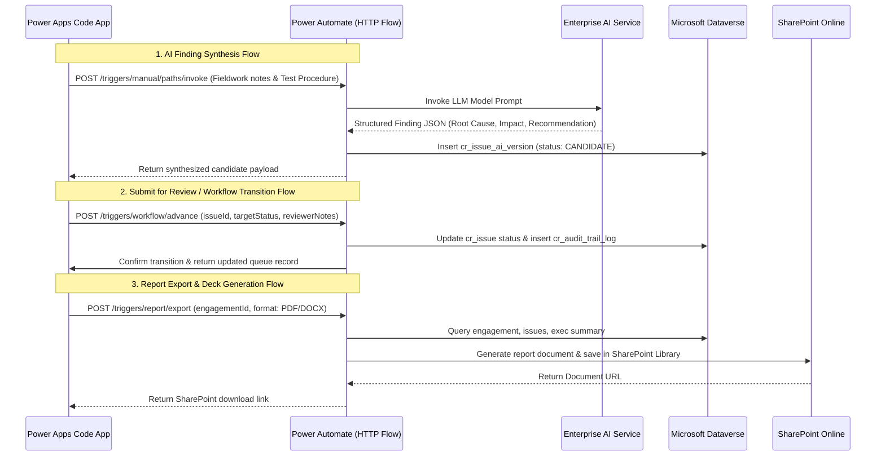

# IAR Reference & Traceability Mapping Guide
## Cross-Reference Matrix for Backup Repositories, Dataverse, Automations & UI System

---

## 1. Executive Purpose & Repository Roles

This document serves as the master architectural directory mapping between the reference backup repositories and the target **Power Apps Code App** production application:

```
┌────────────────────────────────────────────────────────┐
│                      d:/IAR/                           │
├──────────────────────────┬─────────────────────────────┤
│ Backup_JNJ_IAR/          │ Backup_IAR-components/      │
│ [FUNCTIONAL BLUEPRINT]   │ [DESIGN SYSTEM & BRANDING]  │
│ - Audit Business Logic   │ - J&J Brand Colors & Theme  │
│ - Workflow State Machine │ - Shared UI Components      │
│ - Multi-Role Governance  │ - SharedTable & Accordion   │
│ - AI Versioning & Merge  │ - Standardized Form Inputs  │
│ - Mock JSON Data         │ - Consistent Look & Feel    │
└──────────────────────────┴─────────────────────────────┘
                             │
                             ▼
┌────────────────────────────────────────────────────────┐
│               TARGET PRODUCTION BUILD                  │
│  - Power Apps Code App (Frontend React / TypeScript)   │
│  - Microsoft Dataverse (Relational System of Record)   │
│  - Power Automate (HTTP Button Flows & Scheduled Jobs) │
│  - SharePoint (Audit Workpapers & Report Attachments)  │
│  - Azure Data Lake Storage / ADLS (Telemetry & Logs)   │
└────────────────────────────────────────────────────────┘
```

---

## 2. Source Repositories Cross-Reference

### 2.1 `Backup_JNJ_IAR/` (Business Logic & Functional Blueprint)

| Path in `Backup_JNJ_IAR/` | Artifact Type | Purpose & Business Logic Extracted |
| :--- | :--- | :--- |
| [AUDIT_WORKFLOW_AND_DATA_HIERARCHY.md](file:///d:/IAR/Backup_JNJ_IAR/AUDIT_WORKFLOW_AND_DATA_HIERARCHY.md) | Spec | Master data hierarchy (Assessment $\rightarrow$ Engagement $\rightarrow$ Assignment $\rightarrow$ Test Procedure $\rightarrow$ Issue), workflow statuses, and sign-off criteria. |
| [AiVersionManagement.md](file:///d:/IAR/Backup_JNJ_IAR/AiVersionManagement.md) | Spec | 3-phase AI lifecycle: Initial draft synthesis, candidate regeneration, version comparison, and hybrid field-by-field merge. |
| [CommentsManagement.md](file:///d:/IAR/Backup_JNJ_IAR/CommentsManagement.md) | Spec | Field-level comment threads, `@mention` tagging, and strict resolution lock (only tagged user can mark as done). |
| [ComplianceStandardsManagement.md](file:///d:/IAR/Backup_JNJ_IAR/ComplianceStandardsManagement.md) | Spec | Compliance taxonomy mapping (SOX, GxP, ISO, IAPP) and policy violation attribution. |
| [FunctionLogManagement.md](file:///d:/IAR/Backup_JNJ_IAR/FunctionLogManagement.md) | Spec | Audit trail logging, status transition history, and regulatory traceability. |
| [TaxonomyManagement.md](file:///d:/IAR/Backup_JNJ_IAR/TaxonomyManagement.md) | Spec | Audit classification taxonomies (Process areas, Risk categories, Root Cause categories). |
| [src/views/MyAuditsView.jsx](file:///d:/IAR/Backup_JNJ_IAR/src/views/MyAuditsView.jsx) | View | Primary Audit Queue: Portfolio tabs, search/filter, engagement cards, status badges, and action triggers. |
| [src/views/AuditReportView.jsx](file:///d:/IAR/Backup_JNJ_IAR/src/views/AuditReportView.jsx) | View | Detailed Audit Report Studio: Finding workpapers, root cause, impact, recommendations, business responses, and approvals. |
| [src/views/ExecutiveReportView.jsx](file:///d:/IAR/Backup_JNJ_IAR/src/views/ExecutiveReportView.jsx) | View | Executive Summary Report: High-level narrative, process scope matrix, key insights, and VP/Director executive sign-off. |
| [src/views/AuditIssuesView.jsx](file:///d:/IAR/Backup_JNJ_IAR/src/views/AuditIssuesView.jsx) | View | Cross-engagement audit issues ledger with filtering, sorting, and status chips. |
| [src/components/issues/CreateIssueDrawerNew.jsx](file:///d:/IAR/Backup_JNJ_IAR/src/components/issues/CreateIssueDrawerNew.jsx) | Component | Issue creation workflow drawer featuring "Generate with AI" button, prompt synthesis, and in-drawer candidate comparison. |
| [src/components/issues/AiVersionCompareModal.jsx](file:///d:/IAR/Backup_JNJ_IAR/src/components/issues/AiVersionCompareModal.jsx) | Component | Multi-version side-by-side comparison modal with diff highlighting and field selection controls. |
| [src/components/issues/DiscussionModal.jsx](file:///d:/IAR/Backup_JNJ_IAR/src/components/issues/DiscussionModal.jsx) | Component | Field-level discussion thread modal supporting user tagging and resolution status. |
| [src/components/issues/IssueLogsModal.jsx](file:///d:/IAR/Backup_JNJ_IAR/src/components/issues/IssueLogsModal.jsx) | Component | Historical transition log modal showing user attribution, timestamp, and review remarks. |
| [src/components/reporting/WorkflowModal.jsx](file:///d:/IAR/Backup_JNJ_IAR/src/components/reporting/WorkflowModal.jsx) | Component | Engagement-level review progression modal detailing stage transitions and current approver. |

---

### 2.2 `Backup_IAR-components/` (Design System & Standardized UI Components)

| Path in `Backup_IAR-components/` | Component / File | Purpose & UI Consistency Role |
| :--- | :--- | :--- |
| [src/mui.theme.tsx](file:///d:/IAR/Backup_IAR-components/src/mui.theme.tsx) | Theme Definition | Standard J&J corporate brand palette: Red (`#eb1700`), Blue (`#000099`), Black (`#212121`), Grey (`#888b8d`, `#d8d8d8`), typography (`jj-circular`, Arial), component overrides. |
| [src/components/shared/SharedTable.tsx](file:///d:/IAR/Backup_IAR-components/src/components/shared/SharedTable.tsx) | `SharedTable` | Replaces custom/ad-hoc tables in `MyAuditsView` and `AuditIssuesView` with standard pagination, sorting, row selection, and styling. |
| [src/components/shared/SharedAccordion.tsx](file:///d:/IAR/Backup_IAR-components/src/components/shared/SharedAccordion.tsx) | `SharedAccordion` | Replaces custom collapsible sections in `AuditReportView` workpapers and finding groups. |
| [src/components/shared/buttons/SharedButton.tsx](file:///d:/IAR/Backup_IAR-components/src/components/shared/buttons/SharedButton.tsx) | `SharedButton` | Standardized button component (`contained`, `outlined`, `text`) enforcing consistent sizing, colors, and loading states across all drawers and views. |
| [src/components/shared/inputs/SharedTextInput.tsx](file:///d:/IAR/Backup_IAR-components/src/components/shared/inputs/SharedTextInput.tsx) | `SharedTextInput` | Standard text field for issue headers, IDs, and search bars. |
| [src/components/shared/inputs/SharedTextArea.tsx](file:///d:/IAR/Backup_IAR-components/src/components/shared/inputs/SharedTextArea.tsx) | `SharedTextArea` | Standard multi-line text area for Root Cause, Finding Description, Impact, Recommendation, and Management Response. |
| [src/components/shared/inputs/SharedSelect.tsx](file:///d:/IAR/Backup_IAR-components/src/components/shared/inputs/SharedSelect.tsx) | `SharedSelect` | Standard single-select dropdown for Criticality, Status, Process Area, and Risk Category. |
| [src/components/shared/inputs/SharedMultiSelect.tsx](file:///d:/IAR/Backup_IAR-components/src/components/shared/inputs/SharedMultiSelect.tsx) | `SharedMultiSelect` | Multi-select dropdown for Compliance Standards, Assigned Auditors, and Tagged Reviewers. |
| [src/components/shared/inputs/SharedAutocomplete.tsx](file:///d:/IAR/Backup_IAR-components/src/components/shared/inputs/SharedAutocomplete.tsx) | `SharedAutocomplete` | Searchable autocomplete for Test Procedure selection and User directory lookups. |
| [src/components/shared/inputs/SharedRadioGroup.tsx](file:///d:/IAR/Backup_IAR-components/src/components/shared/inputs/SharedRadioGroup.tsx) | `SharedRadioGroup` | Radio group for binary choices (e.g., Repeat Finding Yes/No, Report Type selection). |
| [src/components/shared/common/SharedFieldLabel.tsx](file:///d:/IAR/Backup_IAR-components/src/components/shared/common/SharedFieldLabel.tsx) | `SharedFieldLabel` | Uniform field labels with required indicator styling. |
| [src/components/shared/common/SharedFieldError.tsx](file:///d:/IAR/Backup_IAR-components/src/components/shared/common/SharedFieldError.tsx) | `SharedFieldError` | Standard validation error message rendering. |

---

## 3. Data Transformation Map: Mock JSON to Microsoft Dataverse

| Mock JSON Source in `Backup_JNJ_IAR/src/data/` | Target Microsoft Dataverse Entity | Entity Description & Key Columns |
| :--- | :--- | :--- |
| `assessments.json` | `iar_assessments` (Loaded) | Annual audit portfolios (`iar_assessmentid`, `iar_assessmenttitle`, `iar_startdate`, `iar_enddate`). |
| `engagements.json` | `iar_engagementses` (Loaded) | Audit projects (`iar_engagementsid`, `iar_AssessmentID@odata.bind`, `iar_engagementname`, `iar_reportstatus`). |
| `assignments.json`, `assignmentsData.js` | `iar_securityassignmentses` (Loaded) | Role-to-engagement mapping (`iar_securityassignmentsid`, `iar_EngagementID@odata.bind`, `iar_useremailid` $\rightarrow$ `systemusers.internalemailaddress`, `iar_tmroleid` $\rightarrow$ `iar_tmroleses.iar_tmid` to derive `iar_logickey`). |

| `roles.json` | `iar_tmroleses` (Loaded) | Predefined audit roles (`iar_tmrolesid`, `iar_rolename`: IT/FIN across 5 tiers). |
| `users.json` | `systemusers` (Loaded) | Enterprise users (`systemuserid`, `domainname`, `fullname`, `internalemailaddress`). |
| `testProcedures.json` | `iar_procedureses` (Loaded) | Approved workprograms (`iar_proceduresid`, `iar_procedurecode`, `iar_procedurename`, `iar_EngagementID@odata.bind`; selectable during issue creation, procedure state has no operational significance). |

| `issues.json` | `iar_issueses` (Loaded) | Audit findings (`iar_issuesid`, `iar_issuetitle`, `iar_issuestatus` [creator-driven initial review status], `iar_function` [IT/FinOps track driving `technology_related` AI input], `iar_AccountableFunction` [taxonomy lookup], `iar_rootcause`, `iar_impact`, `iar_recommendation`, `iar_PrimaryBusinessOwner@odata.bind`, `iar_soxreportable`). |
| N/A (Auditee Directory) | `iar_issuebusinessownerses` (Loaded) | Secondary Business Owners per finding (`iar_issuebusinessownersid`, `iar_IssueID@odata.bind`, `iar_SecondaryOwner@odata.bind`, `iar_isdelegated`, `iar_DelegatedBy@odata.bind`). |
| `issueLogs.json` | `iar_issuelogses` (Loaded) | Historical issue workflow transitions and field edit deltas (`iar_issuelogsid`, `iar_IssueID@odata.bind`, `iar_EngagementID@odata.bind`, `iar_LoggedBy@odata.bind`, `iar_logtype`, `iar_logsubtype`, `iar_fieldreference`). |
| `comments.json` | `iar_issuecommentses` (Loaded) | Field-level discussion threads across 31 fields and tagged user resolution locks (`iar_issuecommentsid`, `iar_IssueID@odata.bind`, `iar_field`, `iar_TaggedUser@odata.bind`, `iar_commentcompletionstatus`). |
| `issueAiVersions.json` (AI Triggers) | `iar_aiissuegeneratedlogses` (Loaded) | AI issue generation request triggers and lifecycle status (`iar_aiissuegeneratedlogsid`, `iar_aigenerationstatus`, `iar_type`, `iar_originalissue`, `iar_versionnumber`). |
| `issueAiVersions.json` (AI Fields) | `iar_aigeneratedfieldlogses` (Loaded) | Granular AI generated field output snapshots (`iar_aigeneratedfieldlogsid`, `iar_AIGenerationID@odata.bind`, `iar_fieldname`, `iar_aigeneratedtext`). |
| `issueAiVersions.json` (AI Edits) | `iar_aigeneratedfieldeditlogses` (Loaded) | Auditor edits & refinements to AI generated fields (`iar_aigeneratedfieldeditlogsid`, `iar_AIGeneratedFieldLogID@odata.bind`, `iar_edittype`, `iar_fromtext`, `iar_editedtext`). |
| N/A (AI Reformat Config) | `iar_aiformattingcontextses` (Loaded) | Input-level AI text formatting options & prompt instructions (`iar_aiformattingcontextsid`, `iar_name`, `iar_instruction`, `iar_sortorder`). |
| N/A (AI Reformat Logs) | `iar_aiformattedlogses` (Loaded) | Execution history for input-level AI text reformatting (`iar_aiformattedlogsid`, `iar_FormattingID@odata.bind`, `iar_textinput`, `iar_airesult`, `iar_isedited`). |
| `taxonomies.json`, `taxonomyItems.json` | `iar_taxonomieses` / `iar_taxonomiesmasters` (Loaded) | Master classification taxonomy trees (`iar_taxonomiesid`, `iar_taxonomiesmasterid`). |
| N/A (App Governance) | `iar_administratorses` (Loaded) | Global administrators directory with lookup to `systemusers` (`iar_administratorid`, `iar_Admin@odata.bind`, `statecode`). |
| `auditReportLogs.json` | `iar_auditreportlogs` (Upcoming) | Audit report stage progressions and approval audits (`iar_auditreportlogid`, `iar_EngagementID`, `iar_signofftier`, `iar_action`). |
| `execReportData.js` (AI drafts) | `iar_aisummaryreportgenerations` (Upcoming) | AI executive summary generation telemetry and drafts (`iar_aisummaryreportgenerationid`, `iar_EngagementID`, `iar_synthesizedinsights`). |
| `execReportData.js` (Report record) | `iar_executivesummaryreports` (Upcoming) | Executive report record per engagement (`iar_executivesummaryreportid`, `iar_EngagementID`, `iar_executivenarrative`, `iar_auditrating`, `iar_scopematrix`). |
| `executiveReportLogs.json` | `iar_summaryreportlogs` (Upcoming) | Executive summary report review progression and sign-offs (`iar_summaryreportlogid`, `iar_ExecutiveSummaryReportID`, `iar_action`). |
| `execReportComments` | `iar_summaryreportcomments` (Upcoming) | Executive report section comments and feedback (`iar_summaryreportcommentid`, `iar_ExecutiveSummaryReportID`, `iar_sectionkey`). |
| N/A (Auditee Comments) | `iar_businesscomments` (Upcoming) | Canvas App auditee comments submitted via SharePoint list (`iar_businesscommentid`, `iar_IssueID`, `iar_comment`). |
| `managementResponses` | `iar_issuesbusinessresponses` (Upcoming) | Formal business auditee CAP responses & action plans (`iar_issuesbusinessresponseid`, `iar_IssueID`, `iar_managementresponse`, `iar_actionplan`, `iar_targetdate`). |
| N/A (Audit Trail) | `iar_userlogs` (Upcoming) | Enterprise user activity, navigation, and session compliance audit trail (`iar_userlogid`, `systemusers`). |


---

## 4. Automation & Integration Architecture Map

### 4.1 Power Automate: Instant / HTTP-Triggered Flows
Invoked via HTTP actions from buttons within the Power Apps Code App:



| Flow Name | Trigger Location in UI | Payload & Target Action |
| :--- | :--- | :--- |
| **`AIIssueGeneration`** (`846f04ab-66c1-f111-b377-7c1e520e2b9b`) | "Generate With AI" / "Regenerate" in `CreateIssueDialog` | Passes `auditable_entity`, `audit_engagement_id`, `audit_job_id`, `issue_id` (`iar_aiissuegeneratedlogsid`), `technology_related` (boolean `true` for IT, `false` for FinOps derived from `Function`), `issue`, `operation_type`, `additional_info`; logs to `iar_aiissuegeneratedlogses` (`Pending` $\rightarrow$ `Success`/`Failed` $\rightarrow$ `Issue Created`/`Issue Cancelled`), populates `iar_aigeneratedfieldlogses`, returns synthesized fields for review with remarks support; on creation, sets initial status based on creator persona (Staff, TC, Manager) and Save vs Submit action. |
| **`AITextFormatting`** (`dc7339ee-68c1-f111-b377-7c1e520e2b9b`) | Input-level formatting menu in workpaper inputs | Invokes formatting prompt based on `iar_aiformattingcontextses`; logs execution in `iar_aiformattedlogses` and edits in `iar_aigeneratedfieldeditlogses`. |
| **`FLW-IAR-AdvanceWorkflowStage`** | "Submit to TC", "Submit to Manager", "Submit to Director", "Sign Off" buttons | Validates role permissions; advances issue status in Dataverse; writes immutable entry in `iar_issuelogs`. |
| **`FLW-IAR-RouteToBusiness`** | "Send to Business" button (Director Only) in `AuditReportView` | Triggered by Director; advances issue status to `Pending Business`; provisions entry in SharePoint List `IAR_BusinessOwnerResponses_List`; dispatches notification to Business Owner with Canvas App deep-link. |
| **`FLW-IAR-SyncIssueToSharePoint`** | Issue Create/Edit trigger in Code App | Synchronizes issue details, descriptions, and statuses from Dataverse to the SharePoint List (`IAR_Issues_List`) powering the Business Canvas App. |
| **`FLW-IAR-SyncBusinessComment`** | Submit In-Between Comment in Canvas App | Ingests in-between business comments from `IAR_Issues_List` into Dataverse table `iar_businesscomments` for real-time auditor visibility. |
| **`FLW-IAR-IngestBusinessResponse`**| Submit Response in Business Canvas App | Ingests formal Management Response and CAP from SharePoint List `IAR_BusinessOwnerResponses_List` into Dataverse table `iar_issuesbusinessresponses`; automatically transitions issue status back to `Pending Manager`. |
| **`FLW-IAR-CompileAndExportReport`** | "Complete and Sign-Off" / "Export Report" buttons | Compiles all active issues and executive narrative; converts to branded **PDF Format**; stores in SharePoint `FinalReports/`; returns download URL. |


---

### 4.2 Power Automate: Deployment & Scheduled Background Flows

| Flow Name | Frequency / Lifecycle | Target Objective & Entity Ingestion |
| :--- | :--- | :--- |
| **`FLW-IAR-SeedTeamRoles`** | **One-Time Post-Deployment Only** | **Team Roles Seeding from TeamMate**: Queries the TeamMate role catalog, extracts the 10 required audit roles, populates Role IDs (`TM-2` to `TM-12`), TM IDs (`1` to `10`), Role Names, and custom **`LogicKey`** values (`ITS`, `FIS`, `ITT`, `FIT`, `ITM`, `FIM`, `ITD`, `FID`, `ITV`, `FVP`). Upserts the 10 rows into `iar_tmroleses`. Executed only once across the application lifecycle. |
| **`FLW-IAR-HourlyMasterDataSync`** | **Hourly (Every 1 Hour)** | **TeamMate Master Data Sync & Upsert**: Polls TeamMate upstream audit management repository for new or modified records. Upserts into Dataverse tables: `iar_assessments`, `iar_engagementses`, `iar_procedureses`, `iar_securityassignmentses`, `iar_taxonomiesmasters`, and `iar_taxonomieses`. Maintains read-only reference data for the Code App. |
| **`FLW-IAR-DailyStatusAggregation`** | Nightly (00:00 UTC) | Recalculates engagement sub-statuses, critical issue tallies, and executive rollup metrics across Dataverse. |
| **`FLW-IAR-SlaReviewAlerts`** | Daily (08:00 AM) | Scans issues in `Pending TC`, `Pending Manager`, and `Pending Director`; sends reminder notifications for aging items. |
| **`FLW-IAR-RemediationDateTracker`** | Weekly (Mondays) | Monitors target remediation dates committed by business contacts; alerts Lead Auditor for approaching deadlines. |


---

### 4.3 Storage Integration: SharePoint vs. ADLS

| Asset / Data Stream | Storage Destination | Access Pattern from Code App |
| :--- | :--- | :--- |
| **Audit Evidence Files** | **SharePoint Online** | Linked per issue/workpaper. Stored in `/Sites/IAR/Engagements/{engagementId}/Evidence/`. Uploaded and previewed directly via Code App. |
| **Generated Audit Reports (PDF/DOCX)** | **SharePoint Online** | Stored in `/Sites/IAR/Engagements/{engagementId}/FinalReports/`. Archived with version history and metadata stamps. |
| **System Audit Logs & Regulatory Trails** | **Azure Data Lake Storage (ADLS)** | High-frequency telemetry, granular field edit events, and immutable GxP forensic logs streamed from Power Automate to ADLS Gen2 container `iar-forensic-logs`. |
| **Enterprise Data Extracts & ERP Samples**| **Azure Data Lake Storage (ADLS)** | Read-only large data extracts (SAP, TrackWise, JNJ ERP feeds) queried via Synapse / REST connector for testing evidence. |

---

## 5. Next Steps: Proposed Suite of Requirements Documents

To ensure thorough, professional, and audit-ready project execution, the following suite of formal requirements documents should be prepared:

1. **`docs/REQUIREMENTS.md`**: Master High-Level Requirements & System Architecture *(Already created)*.
2. **`docs/REFERENCE_MAPPING.md`**: Cross-reference directory between backup repositories, Dataverse, Automations, and UI *(This document)*.
3. **`docs/FRD_REPORTING_MODULE.md`**: Detailed Functional Requirements Document for the Reporting Module (Workpapers, AI lifecycle, state transitions, business response loop, sign-offs, permissions).
4. **`docs/DATAVERSE_SCHEMA_SPEC.md`**: Complete Dataverse Data Model (Table definitions, field schemas, relationships, choices, and indexes).
5. **`docs/INTEGRATION_AUTOMATION_SPEC.md`**: Power Automate API contracts (HTTP flow schemas, scheduled flow logic, SharePoint folder structures, ADLS endpoints).
6. **`docs/UI_DESIGN_HARMONIZATION_SPEC.md`**: UI/UX Theming and Component Migration Guide (Applying `Backup_IAR-components` styling and components to `Backup_JNJ_IAR` reporting views).
