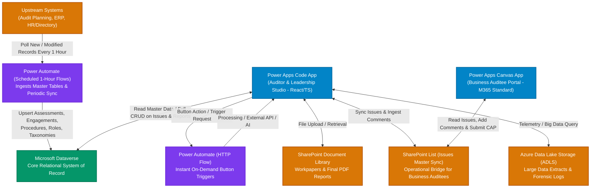

# Johnson & Johnson IAR (Intelligent Audit Reporting)
## System Requirements & Architecture Specification

---

## 1. Executive Overview & Purpose

**IAR (Intelligent Audit Reporting)** is an enterprise audit lifecycle application tailored for internal auditors, lead coordinators, audit managers, directors, executive vice presidents, and business stakeholders. The platform unifies audit execution, evidence management, AI-assisted finding synthesis, review workflows, and executive reporting into a cohesive experience.

---

## 2. Technology Stack & Enterprise Architecture

### 2.1 Core Platform Components
1. **Frontend**: **Power Apps Code App**
   - High-fidelity custom frontend built with modern React / TypeScript and enterprise component standards.
   - Dedicated workspace for Internal Audit team (Staff, TC, Manager, Director, VP).
2. **Primary Storage**: **Microsoft Dataverse**
   - System of record for upstream synchronized master data and application-managed governance entities.
3. **Integration & Automation Engine**: **Power Automate**
   - **HTTP-Triggered Flows**: Invoked via HTTP connector directly from action buttons inside the Code App.
   - **Schedule-Based Flows**: Periodic batch jobs including an hourly scheduled flow checking for new or modified master records and updating Dataverse.
4. **Business Auditee Portal & Bridge**:
   - **SharePoint Dual-List Architecture**: `IAR_Issues_List` (mirror of active findings & in-between business comments) and `IAR_BusinessOwnerResponses_List` (formal CAP response submissions).
   - **Power Apps Canvas App**: Dedicated lightweight portal for business owners and auditees built with standard M365 licensing.
5. **File & Data Lake Storage**:
   - **SharePoint Document Library**: Document repository for workpaper attachments and signed report packages (PDF Format).
   - **Azure Data Lake Storage (ADLS)**: High-scale audit datasets, telemetry, and forensic log streams.

### 2.2 Data Ingestion & Application Ownership Boundaries
The data architecture establishes a clean separation of concerns between upstream master records and application-managed audit governance:

| Architectural Tier | Dataverse Entities | Ownership & Ingestion Mechanism | Application Behavior |
| :--- | :--- | :--- | :--- |
| **One-Time Deployment Seed Data** | `iar_tmroleses` (`iar_tmroles`) | **One-Time Post-Deployment Power Automate Flow** Runs once post-deployment; reads 10 core audit roles from **TeamMate**; seeds TM IDs (`1`-`10`), Role IDs (`TM-2`-`TM-12`), and custom **`LogicKey`** values (`ITS`, `FIS`, `ITT`, `FIT`, `ITM`, `FIM`, `ITD`, `FID`, `ITV`, `FVP`). | **Immutable Role & Governance Catalog** Matched dynamically against `iar_securityassignmentses.iar_tmroleid` to determine user permissions, action button visibility, and approval rights. |
| **Upstream Master Reference Data** | `iar_assessments` `iar_engagements` (`iar_engagementses`) `iar_procedures` (`iar_procedureses`) `iar_securityassignments` (`iar_securityassignmentses`) `iar_taxonomiesmasters` `iar_taxonomies` (`iar_taxonomieses`) | **Scheduled Power Automate Flow (Hourly)** Runs every 1 hour; checks for new or modified records from **TeamMate**; upserts into Dataverse. | **Read-Only / Lookup Data in UI** The application consumes these as reference catalogs (portfolio selectors, engagement cards in the queue, test procedure dropdowns, assigned team roles, taxonomy categorization). |
| **Application-Managed Operational & Governance Data** | `iar_administratorses` (Admin directory) `iar_issueses` (Findings system of record) `iar_issuebusinessownerses` (Secondary business owners) `iar_issuelogs` / `iar_issuelogses` `iar_issuecomments` / `iar_issuecommentses` `iar_auditreportlogs` `iar_aiissuegeneratedlogses` (AI generation requests & status lifecycle: Pending $\rightarrow$ Success/Failed $\rightarrow$ Issue Created/Cancelled) `iar_aigeneratedfieldlogses` (Parsed generated fields: Title, Description, Root Cause, Impact, Recommendation, Non-Compliance JSON, remarks) `iar_aigeneratedfieldeditlogses` (Auditor edits to generated fields) `iar_aiformattingcontextses` (Prompt templates) `iar_aiformattedlogses` (Input-level reformatting logs) `iar_aisummaryreportgenerations` `iar_executivesummaryreports` `iar_summaryreportlogs` `iar_summaryreportcomments` `iar_businesscomments` `iar_issuesbusinessresponses` | **IAR Power Apps Code App (Direct UI & HTTP Flows)** Fully authored, edited, transitioned, and signed off within the application lifecycle. | **Full Interactive CRUD & State Machine** Staff drafting, TC/Manager reviews, AI synthesis and merges, field discussions, auditee business responses, and Director/VP executive approvals. |

### 2.3 Business Auditee Dual-Surface Architecture & Licensing Optimization
To eliminate the requirement for expensive Microsoft Dataverse Premium licenses across broad business stakeholder communities:
1. **Auditor Workspace (IAR Code App)**: Powered by React/TypeScript and Dataverse Web API. Utilized exclusively by certified audit team members.
2. **Business Contact Workspace (Canvas App)**: Powered by standard Microsoft 365 SharePoint licensing. Business owners access their assigned findings via this separate Canvas App.
3. **Synchronization Bridge (SharePoint List)**:
   - When issues are authored or edited in the Code App, finding records are synchronized to a designated SharePoint List.
   - Business contacts are mapped at the **individual Issue Level** (not via TeamMate engagement assignments).
   - Business contacts can review finding details and add comments at any time in the Canvas App.
   - The formal **Management Response & Corrective Action Plan (CAP)** is requested and submitted only when the issue is formally advanced to `Pending Business` by the **Audit Director**.
   - Comments and responses entered in the Canvas App write to the SharePoint List and are surfaced in real time to auditors in the IAR Code App.

---

## 3. Audit Lifecycle Phases & Module Scope

The audit lifecycle encompasses six distinct modules:

| Module / Phase | Role in Audit Lifecycle | Current Project Scope Status |
| :--- | :--- | :--- |
| **1. Pre-Planning** | Annual audit planning, portfolio assessment, risk universe analysis, resource readiness. | **Navigation Only** (Active tab & placeholder state) |
| **2. Planning** | Scoping, initial notification letter, stakeholder alignment, engagement budgeting. | **Navigation Only** (Active tab & placeholder state) |
| **3. Fieldwork** | Test procedure execution, sample testing, audit evidence documentation. | **Navigation Only** (Active tab & placeholder state) |
| **4. Reporting** | **Issue synthesis, AI generation/regeneration, multi-level review approvals, executive reporting, business responses, and final sign-off.** | **IN FULL SCOPE** (Primary focus of current development) |
| **5. Wrap-up** | Remediation tracking, workpaper archival, final close-out letters, audit committee submission. | **Navigation Only** (Active tab & placeholder state) |
| **6. Dashboards** | Executive KPI metrics, open issue heatmaps, aging analysis, cross-engagement trends. | **Navigation Only** (Active tab & placeholder state) |

> [!IMPORTANT]
> **Current Project Boundary**: All six modules remain visible and switchable in the global navigation bar. The development focus for this phase is dedicated exclusively to the **Reporting Module**, delivering all its functional workflows, review tiers, and data integrations.

---

## 4. Key Governance Roles & Workflow Progression in Reporting

The reporting workflow enforces a multi-tier governance model with creator-sensitive entry points and domain tracking:

0. **Global Audit Administrator**: Maintained in dedicated Dataverse table `iar_administratorses` (with `systemusers` lookup). Unrestricted cross-engagement visibility, template management, super-user workflow unlocking, and governance oversight without requiring TeamMate assignment records.
1. **Staff Auditor**: Logs findings, triggers initial AI synthesis, and refines descriptions.
   - *Save Draft*: Finding enters **`Pending Staff`** (`822500000`).
   - *Submit*: Finding routes to **`Pending TC`** (`822500001`).
2. **Team Coordinator (TC)**: Reviews technical accuracy, evidence sufficiency, and workpaper standards.
   - *If TC creates finding*: Save Draft $\rightarrow$ **`Pending TC`** (`822500001`); Submit $\rightarrow$ **`Pending Manager`** (`822500002`).
   - *If reviewing*: Approves finding and advances to `Pending Manager`, or returns to Staff for rework.
3. **Audit Manager**: Conducts supervisory review and adequacy evaluation.
   - *If Manager creates finding*: Save Draft $\rightarrow$ **`Pending Manager`** (`822500002`); Submit $\rightarrow$ **`Manager Completed (Waiting for Other Issues)`** (`822500003`) if other issues are pending, or **`Ready for Director Submission`** (`822500004`) if all sibling issues are completed.
   - *Batch Submission*: Once all findings in an engagement are completed, advances the batch to the Director (`Ready for Director Submission` $\rightarrow$ `Pending Director`).
4. **Audit Director**: Conducts executive review and is the **sole authority to formally route findings to the Business Contact** (`Pending Business`).
5. **Business Contact**: Mapped at the **Issue Level** (`iar_issueses`). Interacts via the dedicated **Power Apps Canvas App** (backed by SharePoint List) to provide management responses, CAP action steps, and target implementation dates.
6. **Post-Response Review Loop**: Upon submission by the Business Contact, findings route **back to the Audit Manager (`Pending Manager`)** to verify remediation adequacy, before advancing back to the **Audit Director**.
7. **Vice President (VP)**: Mandatory executive sign-off authority if an engagement contains **one or more Critical issues** (`Pending VP` $\rightarrow$ `Completed`).

### 4.1 Domain Track vs. Accountable Function
- **`Function`** (`iar_function`): Operational track choice (`IT` [`822500000`] or `FinOps` [`822500001`]). Determines the AI microservice calling input `technology_related` (boolean `true` if `IT`, `false` if `FinOps`).
- **`Accountable Function`** (`iar_AccountableFunction`): Distinct finding taxonomy attribute storing the operational business function responsible for the auditable area (taxonomy-driven reference to `iar_taxonomieses`), completely separate from the AI invocation track.

---

## 5. Architectural Alignment & Next Steps

With the architecture baseline established, detailed requirements discussion for the **Reporting Module** can proceed across:
- **Workpaper Structure**: Finding attributes (Header, Test Procedure, Root Cause, Impact, Recommendation).
- **AI Synthesis Lifecycle**: Generation, iterative refinement, side-by-side candidate comparison, and field-level hybrid adoption.
- **Workflow State Machine**: Status transitions: `Pending Staff` $\rightarrow$ `Pending TC` $\rightarrow$ `Pending Manager` $\rightarrow$ `Ready for Director Submission` $\rightarrow$ `Pending Director` $\rightarrow$ `Pending Business` (submitted by Director) $\rightarrow$ `Pending Manager` (post-business review) $\rightarrow$ `Pending Director` $\rightarrow$ `Pending VP` (if Critical) / `Completed`.
- **Power Automate & Storage Connectors**: HTTP endpoint contracts, Dataverse schema mapping, SharePoint attachment APIs, ADLS endpoints, and the SharePoint List bridge.

